# Retail Performance Root Cause Analytics

**A €731K revenue decline at a 20-store retailer, traced from raw data to root causes, management decisions, early warning, a 13-week forecast and an evidence-grounded AI assistant.**

**Live project page:** [waleedbinumer11624.github.io/Retail-Performance-Root-Cause-Analytics](https://waleedbinumer11624.github.io/Retail-Performance-Root-Cause-Analytics/)

**Interactive dashboard:** [explore the decline by period, store and category](https://waleedbinumer11624.github.io/Retail-Performance-Root-Cause-Analytics/dashboard.html), including store results for H1 against H2 2025

> Brightwater Retail Ltd is fictional. All data is synthetic and generated by this repository. No real company, customer or employee data is used.

**Tech stack:** Python, pandas, SciPy, DuckDB, SQL Server (T-SQL), Google BigQuery, dbt, Power BI (DAX, Power Query, PBIP), Power BI Report Builder (paginated), pytest.

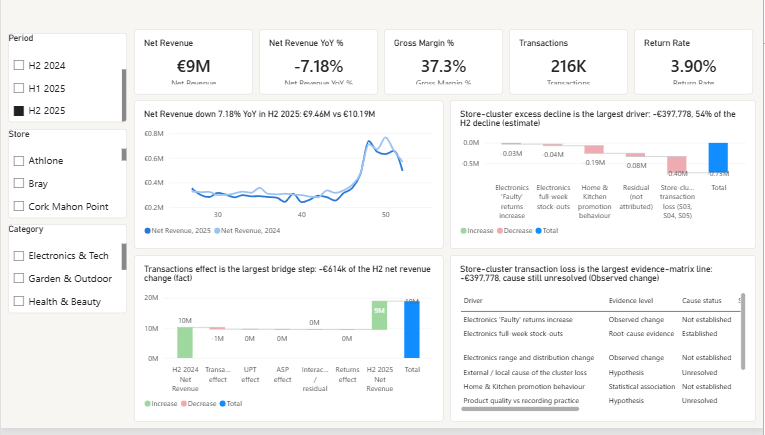

---

## Contents

1. [The business problem](#1-the-business-problem)
2. [What the analysis found](#2-what-the-analysis-found)
3. [Business impact: what a manager gets from this](#3-business-impact-what-a-manager-gets-from-this)
4. [How the project works (business logic)](#4-how-the-project-works-business-logic)
5. [The Power BI dashboard](#5-the-power-bi-dashboard)
6. [Forecasting and early warning](#6-forecasting-and-early-warning)
7. [The AI analytics assistant](#7-the-ai-analytics-assistant)
8. [Set it up on your own computer](#8-set-it-up-on-your-own-computer)
9. [Troubleshooting](#9-troubleshooting)
10. [Repository structure](#10-repository-structure)
11. [Data, governance and limitations](#11-data-governance-and-limitations)

---

## 1. The business problem

Brightwater Retail runs 20 stores in Ireland. In the second half of 2025, net revenue fell against the same period of 2024:

| Measure | Result |
|---|---:|
| H2 2024 net revenue | €10,188,727.55 |
| H2 2025 net revenue | €9,457,457.05 |
| Change | **-€731,270.50** |
| Year-on-year change | **-7.18%** |

Management asked three questions:

1. **Why** did revenue fall?
2. **Where** did the problem start: which stores, categories, products and suppliers?
3. **What** should we do about it, and how would we spot it sooner next time?

The hard part is not finding a number that moved. It is separating what the data **proves** from what it only **suggests**, so that money is spent fixing real causes rather than guesses.

## 2. What the analysis found

### The decline was about fewer customer visits, not prices

An exact Shapley revenue bridge splits the change into four parts and reconciles with no residual:

| Driver | H2 change | Share of decline |
|---|---:|---:|
| Fewer transactions | -€614,363 | 84% |
| Lower average selling price | -€68,077 | 9% |
| Fewer units per transaction | -€34,173 | 5% |
| Higher returns | -€14,657 | 2% |

### Three stores account for over half of it

Stores S03, S04 and S05 lost about **27.8%** of their transactions, while matched control stores lost only **1.1%**. A difference-in-differences estimate puts this cluster's excess decline at **€397,778 (54% of the total)**, with a range of €377,245 to €435,210 across control groups and time windows. The drop started abruptly in mid-July 2025.

**Cause not established.** Footfall, competitor, local-event and store-operations data were not available. The project says so rather than guessing.

### Electronics stock-outs cost measurable sales

Electronics & Tech availability fell from 95.4% to 89.3%, and full-week stock-outs rose from 0 to 786 store-product weeks, mostly on Voltix-supplied products. Estimated lost sales were about **€37,235 gross** and **€23,963 net** after some demand returned (range €23,963 to €44,460). This is the only finding classed as **root-cause evidence**. Why the stock ran out, and whether the supplier or Brightwater's ordering is responsible, is **not** established.

### "Faulty" returns rose, but that does not prove defects

Refunds recorded with the till reason "Faulty" rose by **€31,589** (+90%), concentrated in five stores. A till reason is not a verified defect; QA and batch data would be needed.

### Home & Kitchen promotions are associated with the decline, not proven to cause it

Discount rate rose from about 2.4% to 11.9%. Four estimation methods disagree in sign (M1 -€186,146, M4 -€265,003, M2 +€97,505, M3 +€79,059), so they are reported separately and never added together.

## 3. Business impact: what a manager gets from this

| Without this project | With this project |
|---|---|
| "Revenue is down 7%; cut prices or run more promotions." | 84% of the fall is fewer visits, concentrated in three stores. Discounting everywhere would not fix it. |
| Blame the supplier for empty shelves. | Stock-outs measurably cost sales, but responsibility is unproven. Check purchase orders and deliveries first. |
| Treat "Faulty" returns as a quality crisis. | Capture evidence (QA, batch numbers) before acting. |
| Find out at the half-year review. | A weekly early-warning monitor, back-tested on 2025, would have flagged S03 within **2 weeks** of its change point and S04/S05 within **3 to 5 weeks**. |
| Plan blind. | A 13-week forecast with 80% and 95% intervals, from a model chosen by rolling-origin back-testing. |
| Dig through reports for answers. | Ask the AI assistant; it answers only from validated evidence, cites sources and refuses to invent facts. |

The core principle: **financial size sets investigation priority; evidence strength sets what action is justified.** A large association is not automatically a proven cause.

Every finding carries an evidence label:

| Label | Meaning |
|---|---|
| Observed change (FACT) | Directly measured; does not by itself explain why |
| Root-cause evidence | A quantified mechanism that passes validation and sensitivity checks |
| Statistical association | Measures move together; not proof of cause |
| Estimate | A model-based value with a disclosed method and limits |
| Hypothesis | Plausible, but the data cannot confirm it |
| Unresolved | Size or pattern known; cause not known |

## 4. How the project works (business logic)

The project is built in 11 phases. Each phase checks the outputs of the earlier phases against recorded checksums and re-reconciles the H2 headline before doing anything new, so a later phase can never silently change an earlier result.

```text
Phase 1   Business requirements
Phase 2   Synthetic data generator (1.34M sales lines, 20 stores, 2 years)
Phase 3   Data quality: profile, clean, quarantine, validate
Phase 4   Star schema and governed KPI layer (SQL Server, DuckDB, BigQuery)
Phase 5   Exploratory diagnostics and the revenue bridge
Phase 6   Root-cause investigation with evidence labels
Phase 7   Power BI semantic model, measures and dashboard
Phase 8   Management action and decision framework
Phase 9   Weekly monitoring and early warning (back-tested)
Phase 10  13-week forecasting with model selection
Phase 11  Evidence-grounded AI analytics assistant
```

| Phase | Business question | Key method |
|---|---|---|
| 3 | Can we trust the data? | Data-quality gates, quarantine, audit trail |
| 4 | Do all reports use the same KPI definitions? | Star schema, governed measures, reconciliation |
| 5 | What changed and where? | Shapley revenue bridge, segment diagnostics |
| 6 | What explains it, and how sure are we? | Difference-in-differences, matched controls, permutation and bootstrap tests, lost-sales estimation, sensitivity analysis |
| 8 | What should management do? | Evidence-to-action rules, owners, decision gates |
| 9 | How do we catch it sooner? | Robust baselines, change-point detection, threshold back-testing, data-quality gate |
| 10 | What happens next quarter? | Rolling-origin comparison of baseline and challenger models |
| 11 | Can anyone ask questions safely? | Tool-based retrieval, grounding checks, provenance, guardrails |

## 5. The Power BI dashboard

A Power BI project (PBIP) with 53 tables, 92 DAX measures and 15 relationships, generated from code and validated in Power BI Desktop. Page 1 reconciles exactly to the governed numbers (H2 2025 €9,457,457.05, -7.18%).

| Page | Question it answers |
|---|---|
| 1 Executive overview | What happened, when, and what drove it? |
| 2 Store and customer diagnostics | Where did customers stop coming, and is the cause known? |
| 3 Product, category and inventory | Did availability cost Electronics sales? |
| 4 Returns and quality signals | Are "Faulty" returns a product problem? |
| 5 Promotions and Home & Kitchen | Did promotions cause the H&K decline? |
| 6 Evidence matrix | How strong is each explanation? |
| 7 Investigation priorities | What should be investigated next, and by whom? |
| 8 Forecast | What do the next 13 weeks look like? |
| 9 Data quality | Which issues did the data-quality rules find and treat, and how much data was quarantined? |

Plus two tooltip pages (KPI definitions, evidence details) and two drill-through pages (store detail, product detail).

| | |
|---|---|
| 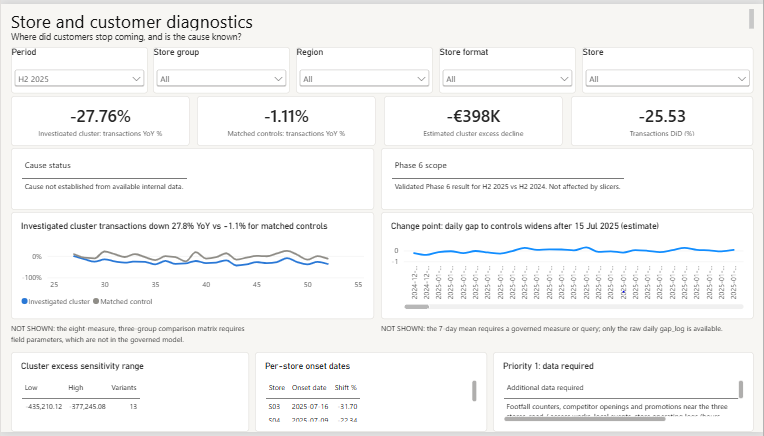<br>**2 Store and customer diagnostics** | 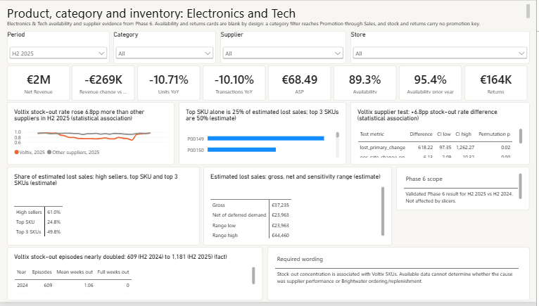<br>**3 Product, category and inventory** |
| 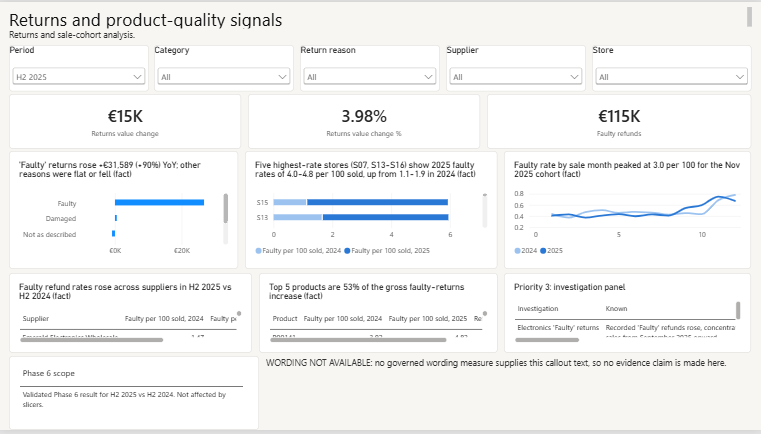<br>**4 Returns and quality signals** | 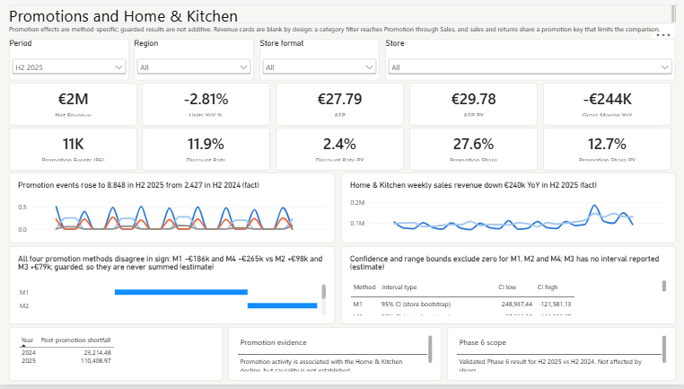<br>**5 Promotions and Home & Kitchen** |
| 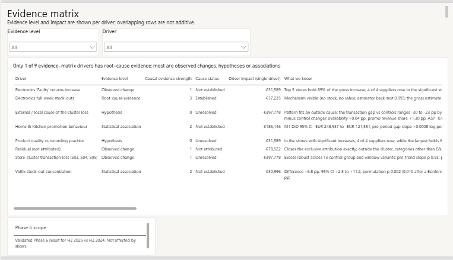<br>**6 Evidence matrix** | 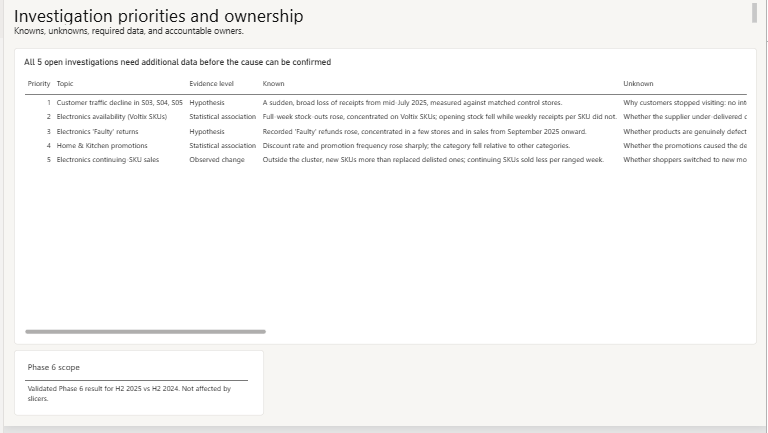<br>**7 Investigation priorities** |
| 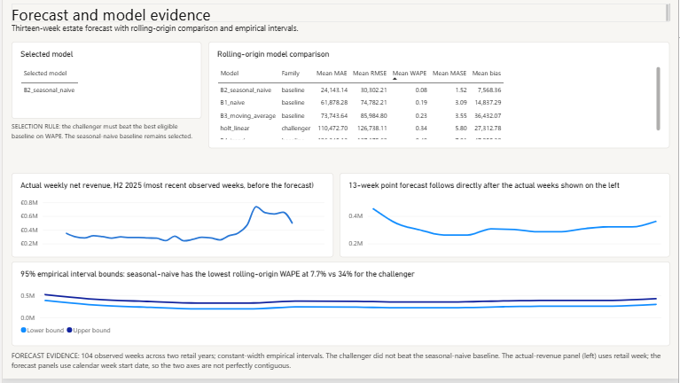<br>**8 Forecast** | 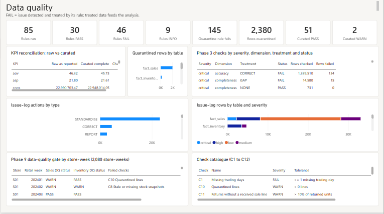<br>**9 Data quality** |

### Paginated report

A print-ready Executive KPI Summary built in Power BI Report Builder on the SQL Server warehouse ([PDF, 2 pages](docs/paginated/Executive_KPI_Summary_H2_2025.pdf), [Excel](docs/paginated/Executive_KPI_Summary_H2_2025.xlsx)). It reads thin views over the governed KPI layer, takes cascading Year/Half parameters and a store parameter, and opens with a validation gate (reconciliation 45/45, KPI validation 38/38). The H2 2025 export reconciles to €9,457,457.05 (-7.18%), and the store rows sum to the estate total.

Other period: H1 2025 ([PDF](docs/paginated/Executive_KPI_Summary_H1_2025.pdf), [Excel](docs/paginated/Executive_KPI_Summary_H1_2025.xlsx)), net revenue €8,629,984.78 (+1.438% vs H1 2024).

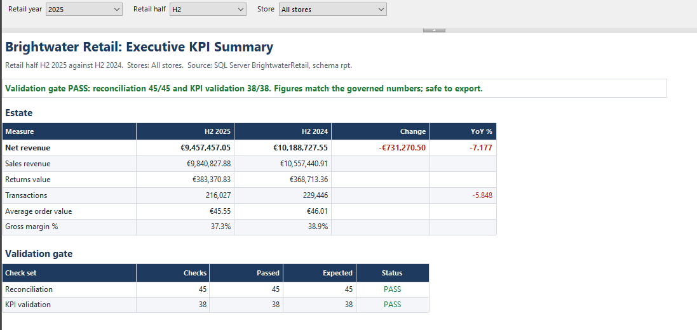

- Report: `powerbi/paginated/Executive_KPI_Summary.rdl` (localhost, Windows authentication).
- Views: `sql/reporting/01_rpt_views.sql` (schema `rpt`). It is not part of the governed build; run it after each SQL Server build: `sqlcmd -S localhost -d BrightwaterRetail -E -C -b -i sql\reporting\01_rpt_views.sql`.
- Tests: `tests/test_paginated_reports.py` checks the report definition and, when SQL Server is available, runs every report query against the governed figures.

## 6. Forecasting and early warning

**Forecast (Phase 10).** Several models were compared with rolling-origin back-testing over 104 weeks. The seasonal-naive baseline was selected because the challenger did not beat it (WAPE 7.65% vs 34.05% for the best challenger). The output is a 13-week forecast with empirical 80% and 95% intervals. Forecasts are always labelled as forecasts, not targets.

**Early warning (Phase 9).** Eight weekly signals (EW01 to EW08) cover store transactions, regions, availability, stock-outs, "Faulty" returns, margin, promotions and data quality. On the 2025 replay, 356 WARNING-or-CRITICAL alerts were raised; 311 fell within known issue periods. A data-quality gate holds back alerts when the underlying data is incomplete. The monitor was checked for look-ahead bias by rebuilding it with data only up to 2025-W40. It is a back-tested design and is not deployed live.

## 7. The AI analytics assistant

Located in `experimental/ai_layer/`. It answers questions such as *"Why did revenue decline?"* or *"How much revenue was lost to stock-outs?"* using only the project's validated outputs.

- **Python calculates; the AI explains.** Numbers come from governed files through 17 fixed tools, never from the language model.
- **Every answer cites its sources** and carries an evidence strength (Strong, Moderate, Limited, Insufficient) taken from the project's own evidence scale, never a made-up percentage.
- **It refuses to invent.** Unsupported questions get *"Insufficient evidence to determine this from the available project data."*
- **Guardrails:** read-only, SELECT-only SQL templates; a path guard blocks evaluation files; retrieved text is treated as data, not instructions (prompt-injection defence); secrets are never logged.
- **Runs with no API key.** Mock mode is the default, so all tests run offline. Anthropic or any OpenAI-compatible endpoint (including a free local model through Ollama) can be enabled with environment variables.

---

## 8. Set it up on your own computer

There are two ways to run the project, plus two optional extras: a BigQuery build (end of Path B) and a dbt port (Path C).

| Path | What you get | Needs | Time |
|---|---|---|---|
| **A. Quick start** (recommended) | All analysis, reports, tests, the dashboard and the AI assistant | Python, Git, Power BI Desktop | About 20 minutes |
| **B. Full SQL Server build** | Everything in A, plus the SQL Server warehouse | Path A plus SQL Server, SSMS and ODBC Driver 18 | About 45 minutes |

Path A uses DuckDB, a small embedded database installed automatically with the Python packages, so no database server is needed.

> **No database connection is needed for the dashboard.** It reads CSV files through four folder parameters. SQL Server is only for rebuilding the warehouse (Path B).

### Before you start: install these (one time)

| Software | Required for | Download |
|---|---|---|
| Python 3.14 (the version the project is tested on) | Everything | https://www.python.org/downloads/ (tick **"Add python.exe to PATH"** during install) |
| Git (latest) | Downloading the project | https://git-scm.com/downloads |
| Power BI Desktop, September 2026 (2.158) or newer | The dashboard (Windows only) | Microsoft Store, or https://powerbi.microsoft.com/desktop |
| VS Code (optional) | Reading and editing the code | https://code.visualstudio.com |
| SQL Server 2022 or later, Developer edition | **Path B only** | https://www.microsoft.com/sql-server |
| SQL Server Management Studio (SSMS) | **Path B only** | https://learn.microsoft.com/sql/ssms |
| ODBC Driver 18 for SQL Server | **Path B only** | https://learn.microsoft.com/sql/connect/odbc |

Check Python and Git are installed by opening **PowerShell** (Windows) or **Terminal** (Mac/Linux) and typing:

```powershell
python --version
git --version
```

Both should print a version number.

### Path A: quick start in 8 steps

**Step 1. Download the project.**

```powershell
cd C:\
git clone https://github.com/WaleedBinUmer11624/Retail-Performance-Root-Cause-Analytics.git
cd Retail-Performance-Root-Cause-Analytics
```

You can clone to any folder with a short path (up to about 80 characters, such as the one above); remember its full path for Step 7. Windows limits full file paths to 260 characters, and some Power BI files sit deep in the project.

**Step 2. Create and activate a virtual environment outside the project folder.**

Keep the environment out of the project folder: the Phase 5 and Phase 7 runs audit every file opened under the project root and would flag the environment's own library files (see KI-04 in `docs/known_issues.md`).

Windows:
```powershell
python -m venv ..\rpca-venv
..\rpca-venv\Scripts\activate
```

Mac/Linux:
```bash
python3 -m venv ../rpca-venv
source ../rpca-venv/bin/activate
```

Your prompt should now start with `(rpca-venv)`. Activate it again every time you open a new terminal.

> If Windows blocks activation with a "running scripts is disabled" message, run `Set-ExecutionPolicy -Scope CurrentUser RemoteSigned` once, then try again.

**Step 3. Install the Python packages.**

```powershell
pip install -r requirements.txt
```

**Step 4. Download the synthetic data.**

The generated data is not stored in the repository because it is large (about 333 MB of CSV files). Download it from the project's GitHub release as one 51 MB zip, check that the file arrived intact, and extract it in the project folder. It creates `data\raw` (the generated extracts, read by Phase 3) and `data\powerbi` (the star-schema extracts the Power BI dashboard reads in Step 7):

```powershell
Invoke-WebRequest -Uri "https://github.com/WaleedBinUmer11624/Retail-Performance-Root-Cause-Analytics/releases/download/v1.0-data/brightwater_raw_data.zip" -OutFile brightwater_raw_data.zip
(Get-FileHash brightwater_raw_data.zip -Algorithm SHA256).Hash
Expand-Archive brightwater_raw_data.zip -DestinationPath . -Force
```

The hash must print `90A845CB362718EFDB451A31F7CAEB6BE967BF500C2A02B1DA3C2F1590B12FC0`. If it does not, download the file again; do not use it. Extract with the command, in the project folder itself (the folder with `README.md`): `data\raw` must sit directly inside it. Windows Explorer's **Extract All** adds an extra `brightwater_raw_data` folder, and Phase 3 then cannot find the data. `-Force` lets you run the command again over an earlier extract.

Mac/Linux: `curl -L -o brightwater_raw_data.zip "https://github.com/WaleedBinUmer11624/Retail-Performance-Root-Cause-Analytics/releases/download/v1.0-data/brightwater_raw_data.zip"`, then `shasum -a 256 brightwater_raw_data.zip` (same value, in lower case), then `unzip -o brightwater_raw_data.zip -d .` (`-o` overwrites an earlier extract without asking).

The zip holds only the generated extracts and the Power BI model extracts, no evaluation file. Regenerating the data from scratch needs a private scenario file that is kept out of the repository by design, so the blind evaluation stays blind (see KI-09 in [docs/known_issues.md](docs/known_issues.md)). For the same reason, `src.data_generation.validate_generated` (which checks the files against the private answer key) cannot run on a clone; Phase 3 runs its own data-quality checks on the extracts.

**Step 5. Run Phase 3 (data quality), then restore the committed reports.**

Phase 3 profiles, cleans and validates the extracts and writes the curated data that the tests and later phases read (`data\processed\curated`). Its data is byte-identical to the governed build. It also rewrites its own report files with run details (the time and your folder path), so restore the committed reports straight after:

```powershell
python -m src.data_quality.run_dq      # Phase 3, about 2 to 6 minutes
git checkout -- reports
```

Phases 4 to 10 do not need to be run again: their governed results are committed in `reports/phase4` to `reports/phase10`, `powerbi/` and `docs/data/`. Start with the executive summaries, for example `reports/phase6/phase6_root_cause_report.md`. Each later phase checks the earlier phases' report files byte for byte against its freeze manifest, so re-running them only works on the original build machine (see KI-10 in [docs/known_issues.md](docs/known_issues.md)).

**Step 6. Run the tests.**

```powershell
python -m pytest
```

656 tests. Expected result on Windows, verified in one full run on 2026-10-27 after Steps 1 to 5 with dbt installed (Path C; SQL Server available, no BigQuery project): 621 passed, 34 skipped and 1 known failure, the Phase 7 line-ending test (KI-03). The skips need the optional sample data (`--mode sample`), evaluation-only files that are kept out of the repository and the data release by design (KI-09), or a BigQuery project (see [docs/bigquery_engine.md](docs/bigquery_engine.md)). Without dbt, the 13 tests that run dbt skip (7 in `tests/test_dbt_project.py`, 6 in `tests/test_robustness_round2.py`); offline, the release-download check skips; without SQL Server, 9 paginated-report tests also skip; without the optional BigQuery client, 1 more; without Node.js and Chrome or Edge, the 23 browser checks. See [docs/known_issues.md](docs/known_issues.md).

**Step 7. Open the Power BI dashboard (manual steps, Windows only).**

1. Open Power BI Desktop.
2. Choose **File > Open**, and open `powerbi\Brightwater_Executive_Dashboard\Brightwater_Executive_Dashboard.pbip`.

   Open the `.pbip` in the `Brightwater_Executive_Dashboard` subfolder.

   If the `.pbip` will not open, go to **File > Options and settings > Options > Preview features**, tick **Power BI Project (.pbip) save option**, **Store semantic model using TMDL format** and **Store reports using enhanced metadata format (PBIR)**, then restart Power BI Desktop.
3. Point the dashboard at your copy of the data. On the **Home** ribbon choose **Transform data > Edit parameters**, then set:

   | Parameter | Set it to |
   |---|---|
   | ModelFolder | `<your clone folder>\data\powerbi` |
   | AnalyticsFolder | `<your clone folder>\powerbi\data` |
   | ForecastFolder | `<your clone folder>\powerbi\forecast_data` |
   | DqFolder | `<your clone folder>\powerbi\dq_data` |

   For example, if you cloned to `C:\Retail-Performance-Root-Cause-Analytics`, ModelFolder is `C:\Retail-Performance-Root-Cause-Analytics\data\powerbi`.
   `data\powerbi` comes from the Step 4 zip; the other three folders are part of the repository.
4. Click **OK**, then **Apply changes** on the yellow banner. If asked about privacy levels, choose **Organizational**. If asked for file access, choose **Anonymous**.
5. Click **Refresh** on the Home ribbon and wait for the data to load (a few minutes; the sales table is large).
6. On Page 1, select **H2 2025** in the Period slicer. The cards should show **€9M** net revenue and **-7.18%** year on year.

**Step 8. Try the AI assistant (no API key needed).**

```powershell
python -m pytest tests/test_phase11_cp2.py tests/test_phase11_cp3.py tests/test_phase11_cp4.py
```

By default the assistant runs in mock mode, which needs no account and makes no network calls. To use a real language model, copy `.env.example` to `.env` and fill in the provider settings described in that file:

```powershell
copy .env.example .env
```

Never commit your `.env` file; it is excluded by `.gitignore`.

To ask the assistant a question from the command line:

```powershell
python -m experimental.ai_layer.cli "Why did revenue decline?"
```

You now have the full project running.

### Path B: add the SQL Server warehouse (optional)

Do Path A first, then:

1. Install **SQL Server 2022 or later, Developer edition** (free; the build was verified on SQL Server 2025), **SQL Server Management Studio (SSMS)** and **ODBC Driver 18 for SQL Server**.
2. Make sure you can sign in to `localhost` with **Windows Authentication**. No username or password is used.
3. Create an empty database called `BrightwaterRetail` (in SQL Server Management Studio: right-click **Databases > New Database**).
4. Build the warehouse:
   ```powershell
   python -m src.sql_model.run_model
   ```
   The build takes about 6 minutes. It is complete when `reports/phase4/run_summary_mssql.json` shows `"passed": true`, with 45/45 reconciliation and 38/38 KPI checks (see KI-05 in [docs/known_issues.md](docs/known_issues.md)).
5. Run Phase 5 against SQL Server instead of DuckDB:
   ```powershell
   python -m src.analytics.run_phase5
   ```

The connection settings (server, database, driver) are in `config/project_config.yaml`. If your server is not `localhost`, change `server` there.

Optional: the same star schema also builds in Google BigQuery (free sandbox), so it runs on three engines (SQL Server, DuckDB and BigQuery), each reconciling 45/45 and 38/38. See [docs/bigquery_engine.md](docs/bigquery_engine.md). Differences between the engines are recorded in KI-07.

### Path C: the dbt port (optional)

`dbt/` is a reconciled port of the governed layer, not a replacement. The governed build (`src/data_quality`, `src/sql_model`, `sql/`) stays the system of record, and every figure in the dbt project is tested against it. It runs locally on DuckDB through the dbt-duckdb adapter: free, no account, nothing that expires. It reads the same files a reviewer has after Steps 4 and 5: the raw extracts from the data release and the Phase 3 outputs.

| dbt layer | Schema | Governed stage it ports |
|---|---|---|
| `models/staging/raw` | `stg_raw` | Phase 3 inputs: the nine raw extracts, as text |
| `models/intermediate/dq` | `int_dq` | Phase 3 data-quality stages (`src/data_quality`), in Phase 3 order |
| `models/staging/curated` | `stg` | Phase 4 staging: the Phase 3 curated files, as text |
| `models/intermediate/dw` | `dw` | Phase 4 star schema (`sql/transformations/07`, `08`) |
| `models/marts` | `mart` | Phase 4 governed KPI views (`sql/analysis/10`) |
| `models/recon` | `recon` | Phase 4 reconciliation and KPI validation (`sql/validation/09`, `11`) |

The `dw`, `mart` and `recon` models are generated from the governed T-SQL by `dbt/scripts/generate_governed_models.py`, using the same T-SQL to DuckDB translation as the governed DuckDB build; a test fails if they drift from the scripts. The data-quality stages are hand-ported SQL. The generic rule tests are written from a compact spec by `dbt/scripts/generate_dq_rule_tests.py`, with each rule's expected counts read from Phase 3's results; a test fails if the committed YAML differs from what it writes.

Run it in its own virtual environment, so dbt's dependencies never touch the governed one (installed into the project environment, dbt would add about 40 packages and downgrade `protobuf` from 7.x to 6.x). Start dbt from the `dbt` folder; it stops with an instruction if Steps 4 and 5 have not been run. Windows:

```powershell
python -m venv ..\rpca-dbt-venv
..\rpca-dbt-venv\Scripts\python -m pip install -r requirements-dbt.txt
cd dbt
..\..\rpca-dbt-venv\Scripts\dbt build --profiles-dir .
..\..\rpca-dbt-venv\Scripts\dbt docs generate --profiles-dir . --static
```

Mac/Linux:
```bash
python3 -m venv ../rpca-dbt-venv
../rpca-dbt-venv/bin/python -m pip install -r requirements-dbt.txt
cd dbt
../../rpca-dbt-venv/bin/dbt build --profiles-dir .
../../rpca-dbt-venv/bin/dbt docs generate --profiles-dir . --static
```

`dbt build` takes about 2 minutes and runs 163 nodes: 72 models, 1 seed and 90 tests. The DuckDB file (`dbt/brightwater_dbt.duckdb`), `dbt/target/` and `dbt/logs/` are git-ignored. `dbt docs generate --static` writes `dbt/target/static_index.html`, which opens straight from disk. The published copy, [docs/dbt/index.html](https://waleedbinumer11624.github.io/Retail-Performance-Root-Cause-Analytics/dbt/), is the same page with every absolute path and machine detail removed: rebuild it with `python dbt/scripts/publish_docs.py` after `dbt docs generate`, and the script refuses to write if any is left. The port's SQL is DuckDB SQL, so it runs on DuckDB only: the `bigquery` target in `dbt/profiles.yml` (your own gcloud login, project ID from `BQ_PROJECT_ID`, no credentials) stops at once with a message pointing to the BigQuery build of the star schema, `python -m src.bigquery_model.run_bigquery`.

What the 90 tests prove (verified 2026-10-26):

- **All 85 Phase 3 data-quality rules.** Each test returns the rule's failing rows and passes only when it finds exactly Phase 3's `rows_failed` among exactly Phase 3's `rows_checked` (from `reports/phase3/dq_rule_results.csv`). 7 rules are generic tests run directly on a raw extract (DS-01, DS-02, DS-04, DD-02, FP-01, FR-01, FI-01). 64 are generic tests over the intermediate models, because they test values after earlier treatments that needed custom SQL to port. 14 are singular tests with custom SQL (DD-01, DD-03, DP-05, DP-09, FS-26, FP-03, SCH-01, SCH-02, TC-02 to TC-07). Failing rows are kept as views in schema `dq_audit`, so each count can be inspected.
- **The port reproduces the curated files**: every key and every value of `fact_sales` (all 24 columns, including each line's `dq_status` and `dq_rules`), `fact_returns`, `fact_inventory` and `fact_targets`, and the rows of `fact_promotions`.
- **Reconciliation 45/45 and KPI validation 38/38**, replacing the governed scripts' `THROW` checks.
- **The headline figures**: retail H2 2025 net revenue EUR 9,457,457.05 (-7.18% on H2 2024) and H1 2025 EUR 8,629,984.78 (+1.438%).
- **The same figures as the governed DuckDB build**: every reconciliation metric and KPI check equals `reports/phase4`, money totals to the cent.

Explore the full lineage, every model's SQL and columns in the [published dbt docs](https://waleedbinumer11624.github.io/Retail-Performance-Root-Cause-Analytics/dbt/). Two views from it:

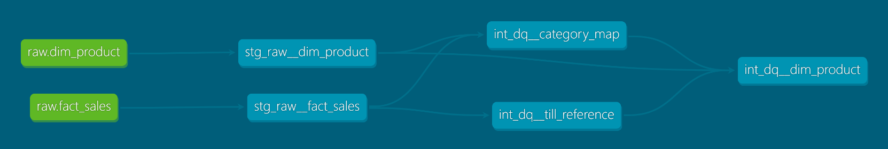

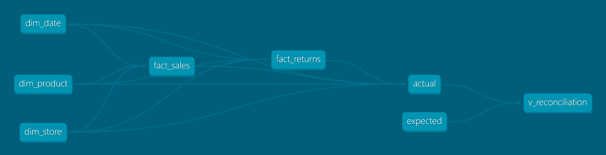

`tests/test_dbt_project.py` runs `dbt build` into a temporary folder and asserts these figures. It finds dbt through the `RPCA_DBT` environment variable, a sibling `..\rpca-dbt-venv`, or `PATH`, and skips cleanly when dbt is not installed. Differences from the governed build are recorded in KI-11 in [docs/known_issues.md](docs/known_issues.md).

### Setup checklist

- [ ] Python and Git installed
- [ ] Project cloned
- [ ] Virtual environment created and activated
- [ ] Packages installed
- [ ] Data downloaded, hash checked and extracted to `data/raw`
- [ ] Phase 3 run and committed reports restored (git checkout -- reports)
- [ ] Tests run: 621 passed, 34 skipped, 1 known failure (KI-03)
- [ ] Dashboard parameters set, refreshed, Page 1 shows -7.18%
- [ ] AI assistant tests pass

---

## 9. Troubleshooting

| Problem | Fix |
|---|---|
| `python` is not recognised | Reinstall Python and tick **"Add python.exe to PATH"**, or use `py` instead of `python`. |
| Activation blocked in PowerShell | Run `Set-ExecutionPolicy -Scope CurrentUser RemoteSigned` once. |
| A phase stops with "inputs changed since the ... freeze" | Phases 3 and 4 rewrite their reports with run details (time, folder paths), so a later phase's byte-level freeze check fails even though the data is identical. Run `git checkout -- reports` and use the committed results of Phases 4 to 10. See KI-10. |
| `test_assets_and_reports_are_reproducible` fails on Windows | Known failure: the frozen Phase 7 runner writes CRLF line endings on Windows. It passes on Linux and macOS. See KI-03 in [docs/known_issues.md](docs/known_issues.md). |
| Phase 3 stops with `FileNotFoundError` for `data\raw\dim_store.csv` | The data release is not in `data\raw`: Step 4 was skipped, or the zip was extracted into a subfolder (Explorer's Extract All creates `brightwater_raw_data\data\raw`). Extract it again with the Step 4 command in the project folder. See KI-12 in [docs/known_issues.md](docs/known_issues.md). |
| `FileNotFoundError` for `data\processed\curated\...csv` when running Phase 4 | The data has not been generated or Phase 3 has not run. Run Steps 4 and 5 in order. See KI-08 in [docs/known_issues.md](docs/known_issues.md). |
| The web dashboard says browsers block pages opened directly from disk | Use the live page, or run `python -m http.server` in the `docs` folder and open http://localhost:8000/dashboard.html. |
| The web dashboard shows cards but no charts | The chart library (Chart.js) could not load, for example because a network blocks cdnjs.cloudflare.com or you are offline. Refresh, or try another network. |
| `pip install -r requirements.txt` fails | Use Python 3.14, the version the project is tested on. |
| `git clone` reports "Filename too long" | The clone folder path is too long for Windows (260 characters in total). Clone to a short folder such as `C:\Retail-Performance-Root-Cause-Analytics`, or run `git config --global core.longpaths true` once and clone again. |
| dbt says `Path '...\.dbt' does not exist` or "dbt must run from the dbt folder" | Start it from the `dbt` folder: `cd dbt`, then the Path C command with `--profiles-dir .`. |
| dbt says "The raw data is missing" or "The curated data is missing" | Run README Steps 4 and 5 first; the message names the missing files and, for a zip extracted into a subfolder, where it was found. |
| dbt says `Cannot open file ... brightwater_dbt.duckdb ... being used by another process` | Another program has the dbt database open (a second dbt run, a Python session, a database browser). Close it and run again. |
| dbt says the version is not supported, or a parse error about `arguments` | The project needs dbt 1.10 or later. Install `requirements-dbt.txt` in its own environment (Path C). |
| `publish_docs.py` says "dbt docs have not been generated" or "machine details left" | Run `dbt docs generate --profiles-dir . --static` in the `dbt` folder first. If it still refuses, an absolute path is in the docs; nothing was written and the previous page is kept. |
| The 23 browser checks (`tests/test_web_robustness.py`) error with `TimeoutExpired` after 600 seconds | Run them on their own: `python -m pytest tests/test_web_robustness.py`. On 2026-10-26 they timed out in one of two full runs that included the dbt build; they passed when run alone and in the other full run (about a minute). The cause was not established. |
| BigQuery tests skip with "sandbox tables expire after 60 days" | Rebuild with `python -m src.bigquery_model.run_bigquery` (see [docs/bigquery_engine.md](docs/bigquery_engine.md)). |
| Report Builder cannot find an `rpt` view | Run `sql/reporting/01_rpt_views.sql` again: each SQL Server build recreates the database. |
| Power BI says a file was not found | The four folder parameters in Step 7 still point to the original author's drive. Set them to your clone folder. |
| Power BI cards show (Blank) | Click **Refresh**, then select a period in the slicer. Some Availability cards are intentionally blank when a category filter is applied; the page subtitle explains why. |
| "Pending changes in your queries" banner | Click **Apply changes**. |
| SQL Server login fails (Path B) | Use Windows Authentication and check the server name in `config/project_config.yaml`. Path A does not need SQL Server. |

## 10. Repository structure

```text
config/                 Project, generator and phase configuration (YAML)
data/                   Raw, processed and dashboard data (generated, not committed)
docs/                   Business requirements and phase design documents
docs/screenshots/       Dashboard screenshots
docs/paginated/         Paginated report exports (PDF, Excel) and screenshots
experimental/ai_layer/  Phase 11 AI analytics assistant
logs/                   Pipeline run logs (written at run time, not committed)
powerbi/                Power BI project (PBIP), DAX, Power Query, theme, dashboard data
powerbi/paginated/      Report Builder report (.rdl)
reports/phase3-10/      Executive summaries, validation reports and result tables
reports/bigquery/       BigQuery build results and engine comparison
sql/                    Schema, staging, transformations, KPI, Power BI, monitoring and report views
src/                    Python packages, one per phase
src/bigquery_model/     Optional BigQuery engine
tests/                  Automated tests (pytest)
tmp/                    Dashboard generator and validators (build_pbip.py, validate_pbip.py,
                        tmdl_grammar_check.py) and governance checks (hash_check.py)
requirements-bigquery.txt  Optional BigQuery dependency
dbt/                    Optional dbt port of the governed layer (DuckDB), see Path C
requirements-dbt.txt    Optional dbt dependencies (own virtual environment)
```

## 11. Data, governance and limitations

**Data.** 20 stores, 1,339,510 sales lines, 34,562 return lines, 939,249 inventory snapshots and 2,077 store-week targets over 2024 and 2025. H2 comparisons use aligned retail weeks.

**Governance.**
- Every phase re-checks earlier outputs against recorded checksums and reconciles the headline before running.
- KPIs are defined once and reused everywhere, from SQL to DAX to the AI assistant.
- The data generator plants known business events and data problems for evaluation. Those answer-key files are never read by the analysis; the code refuses to open them, and tests verify it.
- `tmp/hash_check.py` is an author-machine governance check: on a fresh clone it reports FAIL, because it hashes git-ignored generated files (the .pbix and the generated `data/powerbi` files) that a clone does not have.

**Limitations.**
- The retailer and all data are synthetic; results do not describe real-world performance.
- No footfall, competitor or local-event data, so the S03 to S05 cause remains unresolved.
- Supplier responsibility for stock-outs, verified product defects and promotion causality are not established.
- Inventory is weekly, so partial-week stock-outs cannot be measured.
- Phase 9 thresholds were back-tested on the same period used to assess detection; it is not deployed live.
- The forecast has only two years of history, and its intervals are empirical.

Known issues and how they were resolved are recorded in [docs/known_issues.md](docs/known_issues.md).

---

**The project distinguishes between what the data shows, what the evidence supports, and what still requires investigation.**

*Author: Waleed Bin Umer. MSc Data Analytics, National College of Ireland.*