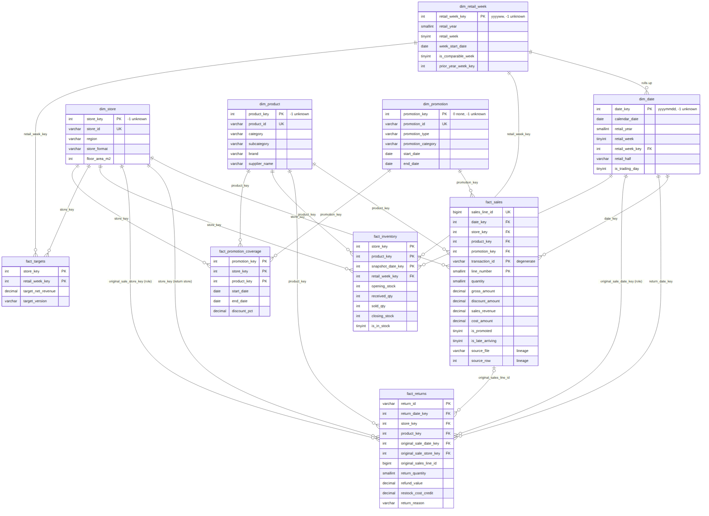

# Phase 4: SQL Analytical Data Model and KPI Layer

| Item | Detail |
|---|---|
| Project | Retail Performance & Root-Cause Analytics System |
| Company | Brightwater Retail Ltd (fictional, synthetic data) |
| Author | Waleed Bin Umer |
| Version | 1.0 (awaiting Phase 4 sign-off) |
| Date | 28 September 2026 |
| Target platform | SQL Server 2022 Developer, SSMS, Power BI Desktop (import) |
| Source | Approved Phase 3 curated datasets (`data/processed/curated/`), frozen and hash-verified |
| Depends on | `docs/01_business_requirements.md` (KPIs), `docs/03_data_quality_design.md` (curated outputs) |

---

## 1. Purpose and scope

Load the trusted Phase 3 data into a SQL Server star schema that Power BI and SQL analysis can use directly, with one governed definition per KPI, and prove that loading changed no business number. Phase 4 builds the analytical foundation. It does not analyse why revenue fell (Phase 7) and does not build Power BI (Phase 8).

## 2. Architecture

```
data/processed/curated/*.csv  (Phase 3, SHA-256 checked against reports/phase3/lineage.json)
        │  runner: @load_staging (pyodbc fast_executemany) or BULK INSERT (SSMS)
        ▼
stg.*    8 landing tables, text columns, CSV column order
        │  07 load dimensions / 08 load facts (typed, keyed, UNKNOWN-safe lookups)
        ▼
dw.*     5 dimensions + 5 facts, PK / FK / CHECK constraints, columnstore on the large facts
        │  10 analytical views
        ▼
mart.*   governed KPI layer: 17 views (1 atomic base, its 2 inputs, 14 analytical) + KPI dictionary
        │
recon.*  09 reconciliation vs Phase 3 trusted outputs, 11 KPI-layer validation; any FAIL stops the build
```

| Schema | Holds | Why separate |
|---|---|---|
| `stg` | The curated files exactly as delivered (text) | Landing is dumb and fast; typing and rules live in one place (07, 08), where conversion failures can be counted |
| `dw` | Star schema | The only tables Power BI imports; constrained so bad rows cannot enter |
| `mart` | Views and the KPI dictionary | KPI logic defined once, in SQL, visible and testable (NFR-07) |
| `recon` | Expected values, actual values, validation views | Evidence that the model matches Phase 3, kept inside the database for audit |

No other infrastructure is used: plain T-SQL scripts, a small Python runner, SQL Server Developer.

### 2.1 Scripts (run order)

| # | Script | Creates / does |
|---|---|---|
| 01 | `sql/schema/01_create_database_and_schemas.sql` | Database `BrightwaterRetail` (simple recovery), schemas `stg`, `dw`, `mart`, `recon` |
| 02 | `sql/staging/02_create_staging_tables.sql` | 8 staging tables; `recon.expected`, `recon.actual` |
| (runner) | `@load_staging`, `@load_expected` | Curated CSVs into `stg`; Phase 3 expected values and tolerances into `recon.expected` |
| 03 | `sql/schema/03_create_dimension_tables.sql` | 5 dimensions (drops facts first) |
| 04 | `sql/schema/04_create_fact_tables.sql` | 5 facts |
| 05 | `sql/schema/05_create_keys_and_constraints.sql` | Fact PKs (grain), 19 foreign keys, 8 check constraints |
| 06 | `sql/schema/06_create_indexes.sql` | Clustered columnstore on `fact_sales` and `fact_inventory`; supporting nonclustered indexes |
| 07 | `sql/transformations/07_load_dimensions.sql` | Dimensions with deterministic surrogate keys and UNKNOWN members |
| 08 | `sql/transformations/08_load_facts.sql` | Facts, with UNKNOWN-safe lookups; columnstore rowgroups compressed |
| 09 | `sql/validation/09_reconciliation.sql` | `recon.dw_totals` (materialised once), `recon.actual`, `recon.v_reconciliation`; THROW on any failure |
| 10 | `sql/analysis/10_analytical_views.sql` | `mart` views and `mart.kpi_definition` |
| 11 | `sql/validation/11_kpi_validation.sql` | Snapshot tables `recon.kv_*`, `recon.v_kpi_validation`, persisted `recon.kpi_validation_result`; THROW on any failure |

Every script is re-runnable from a clean or an existing database: DDL drops and recreates, loads delete before inserting, and schema/database creation checks for existence. `sql/run_all_sqlcmd.sql` runs the same sequence from SSMS or sqlcmd, using `sql/staging/bulk_insert_staging.sql` and the runner-generated `reports/phase4/generated/recon_expected_values.sql`.

### 2.2 How to run

```
python -m src.sql_model.run_model                   # SQL Server, settings in config/project_config.yaml (database)
python -m src.sql_model.run_model --engine duckdb   # local verification engine, no SQL Server needed
```

The runner verifies the curated files against Phase 3's recorded SHA-256, runs the scripts in order, writes `reports/phase4/` (run log, object inventory, reconciliation, KPI validation, build report) and exits with code 1 if any check fails.

### 2.3 Verification without SQL Server (important)

The project's build environment cannot install SQL Server (its network policy blocks Microsoft's package and container registries). The scripts were therefore verified in three ways, and the difference matters:

1. **Syntax:** every statement in every script (196) parses with the T-SQL grammar of sqlglot. Three statements (`ALTER DATABASE ... SET RECOVERY`, two `ALTER INDEX ... REORGANIZE`) are standard T-SQL outside sqlglot's grammar.
2. **Behaviour:** all portable batches (DDL, loads, reconciliation, views) are translated statement by statement from T-SQL to DuckDB and executed on the full curated data; reconciliation and KPI validation pass. SQL Server-only batches (constraints, columnstore indexes, THROW) are not executed there; instead the tests parse every PK, FK and CHECK from script 05 and prove each one holds on the loaded data.
3. **Independent SQL Server review:** a separate reviewer, working only from the scripts, checked every statement against SQL Server 2022 rules (batching, types, decimal precision, constraints, sqlcmd and pyodbc behaviour) and simulated the decimal arithmetic on the curated data. It found three blockers that DuckDB cannot reveal, all fixed and re-reviewed: (a) SQL Server rounds `SUM(DECIMAL(38,2)) - SUM(DECIMAL(38,4))` to 2 decimals because the result would exceed 38 digits, which would have moved COGS by EUR 0.225 across store-days and failed the KPI check; component sums are now cast to DECIMAL(19,2)/(19,4) before any subtraction (a test enforces this); (b) a DuckDB-only batch would have been sent to SQL Server by sqlcmd; (c) the filtered index requires QUOTED_IDENTIFIER ON, which sqlcmd.exe only sets with `-I`. Its other findings (materialising validation inputs, transactional chunked staging loads, quoted `:r` paths, stale result tables, the UNKNOWN-product guard) are also applied.

Engine differences found and designed out: DuckDB does not widen `SMALLINT * 100` to INT (explicit CAST added), returns a DECIMAL median rounded to 2 dp where SQL Server's `PERCENTILE_CONT` returns FLOAT (the ordered value is cast to FLOAT), and has no BIT arithmetic (flags are TINYINT, which SQL Server can also SUM). The definitive proof is one run of `python -m src.sql_model.run_model` on SQL Server, which executes the same scripts including the constraints and THROW checks.

## 3. Star schema



Source: `docs/diagrams/04_star_schema.mmd` (Mermaid; renders on GitHub), `04_star_schema.svg`.

### 3.1 Tables and grain

| Table | Type | Grain (one row per) | Rows |
|---|---|---|---|
| `dw.fact_sales` | Transaction fact | POS receipt line (`transaction_id`, `line_number`) | 1,339,510 |
| `dw.fact_returns` | Transaction fact | Returned line (`return_id`), on return date at returning store | 34,562 |
| `dw.fact_inventory` | Periodic snapshot | Store x product x retail week (Sunday closing), for ranged products | 939,249 |
| `dw.fact_targets` | Periodic snapshot (plan) | Store x retail week | 2,077 |
| `dw.fact_promotion_coverage` | Factless fact | Promotion x product x store | 49,430 |
| `dw.dim_date` | Dimension | Calendar day (731) + UNKNOWN | 732 |
| `dw.dim_retail_week` | Dimension (shrunken roll-up of date) | Retail week (105) + UNKNOWN | 106 |
| `dw.dim_store` | Dimension | Store (20) + UNKNOWN | 21 |
| `dw.dim_product` | Dimension | SKU (600) + UNKNOWN (from Phase 3) | 601 |
| `dw.dim_promotion` | Dimension | Promotion event (136) + "No promotion" + UNKNOWN | 138 |

### 3.2 Design decisions

| Decision | Alternative | Why |
|---|---|---|
| Separate `fact_returns` | Negative lines in `fact_sales` | Returns have their own date, store and reason, and the BRD counts them on the return date at the returning store (assumption 2). Merging them would make Net Revenue depend on sign conventions |
| `dim_promotion` + factless `fact_promotion_coverage` | Promotion attributes on sales lines only | Promotion analysis needs the promoted SKUs that did *not* sell, and a promotion header (window, depth range, category) independent of sales |
| `dim_retail_week` | Weekly facts keyed to a day | Targets and stock are weekly. Keying them to a week, not a day, prevents day-level filters (such as Saturday) from silently applying to weekly numbers; the week also carries `prior_year_week_key` for week-aligned YoY |
| Degenerate `transaction_id` in `fact_sales` | A receipt dimension | A receipt has no attributes beyond store, date and time, already on the line; a 835k-row dimension would add a join and nothing else |
| `return_reason` as a fact attribute | `dim_return_reason` | Five values, no attributes; a dimension adds no analytical value |
| Store `gross_amount` on the fact | Compute in views | The BRD defines Gross Sales as SUM(quantity x unit_price); storing it keeps Power BI measures simple, and a CHECK constraint guarantees it equals quantity x unit_price |
| Keep `dq_status`, `dq_rules`, `source_file`, `source_row` on facts | Drop lineage | Every analytical number can be traced to the raw line and its Phase 3 treatment |
| Full refresh | Incremental load / SCD2 | The source is a two-year static extract with no attribute history; a deterministic full rebuild is simpler and reproducible |

### 3.3 Relationships and cardinality

All relationships are one dimension row to many fact rows, enforced by foreign keys (script 05).

| From (many) | To (one) | Key | Role |
|---|---|---|---|
| `fact_sales` | `dim_date`, `dim_store`, `dim_product`, `dim_promotion` | `date_key`, `store_key`, `product_key`, `promotion_key` | |
| `fact_returns` | `dim_date` | `return_date_key` | Return date (active in Power BI) |
| `fact_returns` | `dim_date` | `original_sale_date_key` | Original sale date (role-playing, inactive in Power BI) |
| `fact_returns` | `dim_store` | `store_key` | Returning store (active) |
| `fact_returns` | `dim_store` | `original_sale_store_key` | Store of the original sale (role-playing, inactive) |
| `fact_returns` | `dim_product` | `product_key` | |
| `fact_returns` | `fact_sales` | `original_sales_line_id` | Optional (0..1) link to the sale line; not a constraint (fact-to-fact) |
| `fact_inventory` | `dim_date`, `dim_retail_week`, `dim_store`, `dim_product` | `snapshot_date_key`, `retail_week_key`, ... | |
| `fact_targets` | `dim_retail_week`, `dim_store` | `retail_week_key`, `store_key` | |
| `fact_promotion_coverage` | `dim_promotion`, `dim_store`, `dim_product` | | |
| `dim_date` | `dim_retail_week` | `retail_week_key` | Roll-up |

Role-playing dates are implemented as two foreign keys to the one `dim_date`, not as copies of the dimension: one calendar to maintain, and Power BI activates the role it needs with USERELATIONSHIP.

## 4. Key strategy

| Dimension | Key | How assigned | Why |
|---|---|---|---|
| `dim_date` | `date_key` INT yyyymmdd | From the date | Readable, sortable, stable; the industry norm for dates |
| `dim_retail_week` | `retail_week_key` INT yyyyww | From retail year and week | Same reasons; `prior_year_week_key` is simple arithmetic |
| `dim_store`, `dim_product`, `dim_promotion` | INT surrogate | `ROW_NUMBER()` over the natural key at load | Narrow integer joins; insulates facts from source code changes; **deterministic**, so a rebuild from the same curated files yields identical keys (tested) |
| `fact_sales` | `sales_line_id` BIGINT | `ROW_NUMBER()` over (`transaction_id`, `line_number`) | Compact link from returns to the sale line |

Natural keys are kept on every dimension with a UNIQUE constraint (they drive the load lookups and let analysts search by `store_id` or `product_id`). IDENTITY columns were not used: their values depend on insert order and history, which would make rebuilds non-reproducible.

## 5. UNKNOWN-member strategy

| Member | Key | Used when | Rows using it |
|---|---|---|---|
| Unknown product | `product_key = -1` | Sales lines Phase 3 could not attribute to a product (blank or invalid code, no linked return) | 1,293 sales lines (EUR 38,665) |
| Unknown promotion | `promotion_key = -1` | Promoted line whose promotion code could not be identified | 1 sales line |
| No promotion | `promotion_key = 0` | Line not on promotion; this is a valid state, not missing data | 1,077,994 sales lines |
| Unknown date | `date_key = -1` | Original sale date of a return whose sale line is not in `fact_sales` | 1,194 returns: 1,049 no-receipt, 144 sale line never received, 1 sale line quarantined in Phase 3 |
| Unknown store | `store_key = -1` | Original sale store, same cases | the same 1,194 returns |
| Unknown retail week | `retail_week_key = -1` | Safety member | 0 |

Why: every fact row must join to every dimension (no NULL foreign keys, which Power BI shows as "(Blank)" and SQL inner joins silently drop). Totals therefore stay complete (the 1,293 unknown-product lines are in Net Revenue) while product analysis can exclude `is_unknown = 1`. Lookups in 08 use `LEFT JOIN ... COALESCE(key, -1)`, so a missing member can never drop a row, and the reconciliation compares the number of rows on each UNKNOWN member with the curated data (any unexpected UNKNOWN fails the build).

## 6. Source-to-target mapping

Staging holds the curated columns as text; the table below maps curated column to target column and the transformation applied in 07 / 08. Business values are not changed: only keys, flags and `gross_amount` are derived.

| Target | Source (curated) | Transformation |
|---|---|---|
| `dim_date.date_key` ... `same_day_last_year` | `dim_date.*` | Typed; booleans "True"/"False" to TINYINT; `year_month`, `retail_week_key`, `same_day_last_year_key` derived |
| `dim_retail_week.*` | `dim_date` | Grouped by retail year and week: first/last day, days in week, half; comparable = 7 days in retail 2024-2025 |
| `dim_store.*` | `dim_store.*` | Typed; surrogate key; UNKNOWN row added |
| `dim_product.*` | `dim_product.*` | Typed; curated UNKNOWN product becomes key -1; `status` to `product_status` |
| `dim_promotion.*` | `fact_promotions` | One row per `promotion_id`: min start, max end, depth range, stores and products covered, category of covered products (or Mixed); members 0 and -1 added |
| `fact_sales` keys | `transaction_date`, `store_id`, `product_id`, `promotion_id` | Lookups; blank promotion to 0, unmatched to -1 |
| `fact_sales` measures | `quantity`, `unit_price`, `discount`, `revenue`, `unit_cost`, `cost`, `margin` | Typed as delivered (DECIMAL); `gross_amount` = quantity x unit_price; `revenue` to `sales_revenue`, `discount` to `discount_amount`, `cost` to `cost_amount`, `margin` to `margin_amount` |
| `fact_sales` flags and lineage | `is_late_arriving`, `is_imputed`, `extract_*`, `dq_*`, `source_*` | Booleans to TINYINT; `is_promoted` = promotion present |
| `fact_returns` | `fact_returns.*` + `fact_sales` | Lookups; original sale date/store/line from the loaded sale line (else -1 / NULL); `restock_cost_credit` = returned units x product's median till unit cost when restockable (section 7.1) |
| `fact_inventory` | `fact_inventory.*` | Lookups; week key from the snapshot date; `is_in_stock` = closing_stock > 0 |
| `fact_targets` | `fact_targets.*` | Week key = retail year x 100 + week |
| `fact_promotion_coverage` | `fact_promotions.*` | Lookups; dates and depth as attributes |

Quarantined rows are not in the curated files, so they cannot reach `dw`; the tests additionally check that no fact row carries the `source_file`/`source_row` of any quarantined row.

## 7. KPI layer

### 7.1 Governed definitions (BRD section 5)

One definition each, stored in `mart.kpi_definition` and implemented once in `mart.v_performance_store_day`, from which every other KPI view aggregates.

| KPI | Definition | SQL |
|---|---|---|
| Gross Sales | Quantity x unit price, before discount, excl. VAT | `SUM(gross_amount)` |
| Discount Value | Line discounts | `SUM(discount_amount)` |
| Sales Revenue | Gross Sales - Discount Value | `SUM(sales_revenue)` |
| Returns Value | Refund values, on return date at returning store | `SUM(refund_value)` |
| Net Revenue | Sales Revenue - Returns Value (headline) | `sales_revenue - returns_value` |
| COGS | Cost of units sold - cost of returned-to-stock units | `SUM(cost_amount) - SUM(restock_cost_credit)` |
| Gross Margin / % | Net Revenue - COGS; / Net Revenue | recomputed from sums |
| Transactions | Distinct receipts | `COUNT(DISTINCT transaction_id)` (additive across stores and days only) |
| Units Sold | Quantity | `SUM(quantity)` |
| AOV, UPT, ASP | Sales Revenue / Transactions; Units / Transactions; Sales Revenue / Units | recomputed from sums |
| Return Rate % (value) | Returns Value / Sales Revenue | recomputed from sums |
| Promo Revenue Share % | Sales Revenue on promoted lines (incl. unknown promotion) / Sales Revenue | recomputed from sums |
| Stock Availability % | In-stock ranged store-SKU-weeks / ranged store-SKU-weeks | `SUM(is_in_stock) / COUNT(*)` |
| Target vs Actual | Net Revenue - Target; Net Revenue / Target | `mart.v_performance_store_week` |
| YoY Growth % | (Period / same retail period last year - 1) x 100, week-aligned | `mart.v_yoy_segment_period`, `mart.v_yoy_store_week` |

**COGS returned-to-stock cost.** The BRD says "cost of returned-to-stock items" without naming the cost basis. Phase 3 reconciled it as restockable returned units x the product's median unit cost across its sales lines, so Phase 4 uses exactly that (`restock_cost_credit`, computed once at load). Changing the basis (for example to the linked sale line's cost) would be a definition change for the business to approve, not a modelling choice.

### 7.2 Rules that keep KPIs consistent

* Ratios are always recomputed from summed numerators and denominators, never averaged.
* Transactions are additive across stores and days (a receipt belongs to one store on one day) but not across products or categories; category views expose `transactions_with_category` and no AOV.
* Returns are attributed to the returning store and return date; category views attribute them to the returned product's category.
* Stock quantities are semi-additive: sum across stores and products for one week, never across weeks.
* Money component sums are bounded to DECIMAL(19,2) (DECIMAL(19,4) for the restock credit) before they are subtracted, so SQL Server never rescales and rounds a KPI; validation identities compare in FLOAT.
* Retail year 2026 week 1 (29-31 Dec 2025) is a 3-day partial week; `is_comparable_week = 0`, and YoY views compare only full weeks or the matching half.

### 7.3 Analytical views

| View | Grain | Supports |
|---|---|---|
| `mart.v_performance_store_day` | Store x day | The governed base: every additive component |
| `mart.v_sales_store_day`, `mart.v_returns_store_day` | Store x day | Inputs to the base |
| `mart.v_performance_store_week` | Store x retail week | Time series, Target vs Actual, AOV/UPT/ASP, GM % |
| `mart.v_kpi_store_period` | Store x retail year x H1/H2/FY | Store scorecards with region and format |
| `mart.v_kpi_segment_period` | Estate / Region / Format / Store x year x period | All KPIs in one shape for any segment |
| `mart.v_kpi_estate_period` | Year x period | Headline KPIs incl. stock availability |
| `mart.v_yoy_segment_period` | Segment x year x period | YoY growth for revenue, transactions, AOV, UPT, ASP, margin |
| `mart.v_yoy_store_week` | Store x retail week | Week-aligned YoY time series |
| `mart.v_performance_category_week` | Category x retail week | Category sales, returns, net revenue, margin, promo share |
| `mart.v_kpi_category_period` | Category x year x period | Category KPIs with YoY |
| `mart.v_product_store_week` | Product x store x week | Sales next to the stock snapshot (availability vs sales) |
| `mart.v_availability_store_week`, `mart.v_availability_category_week` | Store / category / supplier x week | Stock Availability % |
| `mart.v_promotion_performance` | Promotion | Coverage, promoted units, revenue, discount cost, line margin |
| `mart.v_returns_analysis` | Week x store x category x reason | Returns value, units, restockable, linked, cross-store |
| `mart.v_sales_line` | Sales line | Drill-through with all attributes and lineage |

The views expose measures by segment; they do not rank, decompose or explain the revenue change.

## 8. Reconciliation (mandatory proof)

`recon.expected` is loaded from Phase 3's own outputs; `recon.actual` is computed independently from `stg` and `dw`; `recon.v_reconciliation` compares them with explicit tolerances (`config/sql_model_config.yaml`). A metric outside tolerance, or present on only one side, is a FAIL, and the build stops (THROW on SQL Server, exit code 1 from the runner).

| Metric group | Metrics | Tolerance |
|---|---|---|
| Row counts | 8 staging tables, 4 dimensions, 5 facts vs curated files (Phase 3 lineage) | exact |
| UNKNOWN usage | Unknown product / promotion / no-promotion lines vs curated; unknown store / date keys in facts; silent conversion failures | exact |
| Financial | Gross Sales, Discount, Sales Revenue, Returns Value, Net Revenue, COGS, Gross Margin, H2 2024 and H2 2025 Net Revenue | EUR 0.01 |
| Operational | Sales lines, Transactions, Units, Returns rows | exact |
| Ratios | GM %, AOV, UPT, ASP, Return Rate, Promo Share, Stock Availability 2024 | 0.000001 |
| Growth | H2 YoY % (week-aligned) | 0.0001 percentage points |

`recon.v_kpi_validation` then proves the governed views agree with those reconciled totals and with each other (store, region, format, category, week, product and promotion roll-ups all equal the estate) and that the BRD identities hold on every period row.

## 9. Indexing and physical design

| Object | Choice | Reason |
|---|---|---|
| `fact_sales` (1.34M), `fact_inventory` (0.94M) | Clustered columnstore; nonclustered PK on the grain | Analytical scans and aggregations read only needed columns, compressed; about 1M rows per rowgroup suits these sizes. The NC PK still enforces the grain. `REORGANIZE ... COMPRESS_ALL_ROW_GROUPS` after load avoids open delta stores |
| `fact_returns`, `fact_targets`, `fact_promotion_coverage` | Rowstore, clustered PK; NC indexes on return date/store, product, sales-line link (filtered), coverage store/product | Too small for columnstore to help; indexes match the view joins |
| Dimensions | Clustered PK on surrogate key; UNIQUE on natural key | Tiny tables; the unique index serves load lookups |
| Foreign keys | Created before load, therefore trusted | Rejects orphans at insert; lets the optimiser eliminate joins |
| Check constraints | Gross, revenue and margin identities; positive quantities and values; 0/1 flags | Guarantees the arithmetic every KPI depends on |
| No separate FK indexes on columnstore facts | | Segment elimination covers them; extra B-trees would slow loads |
| Views, not indexed views | | Power BI imports the dw tables; the views serve SQL analysis and validation at this data size |

## 10. Assumptions

1. The Phase 3 curated files are the single source; the model never reads raw or quarantined data, and the curated files must match Phase 3's recorded SHA-256.
2. COGS returned-to-stock cost uses the Phase 3 basis (section 7.1) until the business decides otherwise.
3. Promoted share includes the one line with an unknown promotion (it carries a discount), as in Phase 3.
4. Returns count against the returning store and return date (BRD assumption 2).
5. The retail calendar in `dim_date` (Phase 1/2) is authoritative for weeks, halves and YoY alignment.
6. Promotion windows that run past 31 Dec 2025 are kept as attributes (dates), not date keys.
7. Full refresh is acceptable: the source is a static two-year extract.

## 11. Limitations

* **Not executed on SQL Server in this environment.** The T-SQL was parsed and its portable logic executed on DuckDB with full reconciliation; constraints, columnstore indexes and THROW were verified by tests but not executed. One run of the runner on SQL Server 2022 is needed to close this gap (section 2.3).
* The SSMS/sqlcmd path (`sql/run_all_sqlcmd.sql`) needs `-I` and the correct `RowTerminator` for the curated files' line endings (LF when Phase 3 ran on Linux/macOS, CRLF when it ran on Windows). The Python runner has neither constraint and is the recommended path.
* Unknown-product lines (EUR 38,665) cannot be analysed by product or category (they appear as category "Unknown").
* Two S13 store-days of POS data were never delivered (Phase 3); the model reports what exists and does not impute.
* Stock is weekly; intra-week stock-outs are invisible.
* No customer dimension exists (BRD assumption 7); transactions are the visit proxy.
* Views are recomputed on every query; if SQL-side analysis becomes slow on larger data, the store-day base could be materialised as a table.

## 12. Testing

`tests/test_phase4_sql_model.py` builds the model once from the full curated data and checks: grain uniqueness for every table (parsed from script 05), all 19 foreign keys and 8 check constraints, UNKNOWN members (existence, meaning, usage counts), mandatory attributes, fact-to-dimension joins, traceability to raw lines, exclusion of quarantined rows, value pass-through, idempotent re-runs, that a tolerance breach or missing metric fails, T-SQL parsing of every statement, CREATE VIEW batch rules, staging column order vs the CSV headers, the KPI dictionary, required views, and isolation from evaluation-only assets (code scan, input whitelist and a trace of every file opened during the build).
