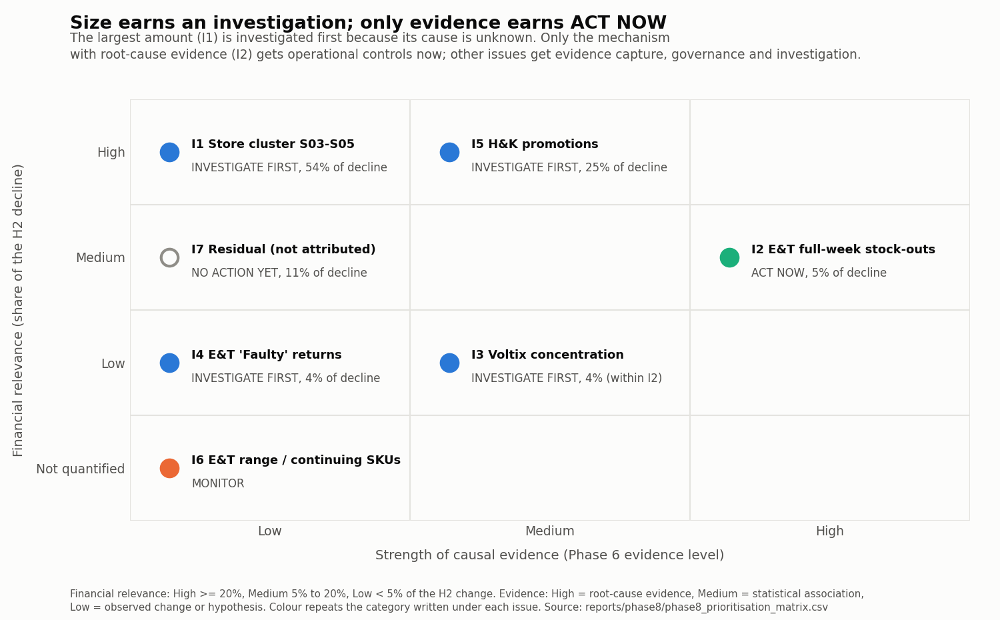

# Brightwater Retail: H2 2025 net revenue decline, executive action plan

**For:** Head of Retail, Commercial Director, Finance Director, Supply Chain Manager, Trading Manager, Operations Manager, Data/BI Lead  
**Status:** PROPOSED for management review. Every analytical figure is a validated Phase 5 to 7 result; owners, judgement ratings, timings, durations and threshold concepts are proposals.  
**Basis:** frozen Phase 1 to 7 outputs (checksums verified at the start of this run). This plan adds no new analysis and does not depend on the Power BI Desktop build (Phase 7A).

## 1. The position in one page

**What happened (FACT).** H2 2025 net revenue was €9,457,457.05 against €10,188,727.55 in H2 2024: -€731,270.50 (-7.18%). The figure reconciles to the cent across Phases 4 to 7.

**What we know, and how firmly.**

| Issue | Share of decline | Evidence (Phase 6) | Cause | Decision |
|---|---|---|---|---|
| I1 Store-cluster transaction loss (S03, S04, S05) | 54% | D01: Observed change; D02: Hypothesis | D01: Unresolved; D02: Unresolved | **INVESTIGATE FIRST** |
| I2 Electronics & Tech full-week stock-outs | 5% | D03: Root-cause evidence | D03: Established only for lost sales during full-week stock-outs; why stock ran out: not established (I3) | **ACT NOW** |
| I3 Voltix Distribution Ltd stock-out concentration (supply vs ordering) | (4%, within I2) | D04: Statistical association | D04: Not established | **INVESTIGATE FIRST** |
| I4 Electronics & Tech 'Faulty' returns | 4% | D05: Observed change; D06: Hypothesis | D05: Not established; D06: Unresolved | **INVESTIGATE FIRST** |
| I5 Home & Kitchen promotions | 25% | D07: Statistical association | D07: Not established | **INVESTIGATE FIRST** |
| I6 Electronics & Tech range and continuing-SKU sales | not quantified | D08: Observed change | D08: Not established | **MONITOR** |
| I7 Residual decline not attributed | 11% | D09: Observed change | D09: Not attributed | **NO ACTION YET** |

Shares come from the exclusive Phase 6 attribution: unrounded, the five components (I1, I2, I4, I5, I7) add to 100% of the -€731,270.50 change; the rounded figures shown add to 99%. I3 is a slice of I2 and is not added; I6 is a partition, not an estimate.

**What we can safely do now (ACT NOW).** An action can be ACT NOW, even inside an INVESTIGATE FIRST issue, only if it is reversible, low effort and low risk, and it is one of three things: an operational control resting on root-cause evidence (only I2 qualifies), evidence capture that would otherwise be lost, or a governance control that changes no commercial lever.

- **A07** Weekly zero-stock exception list for the fastest-selling Electronics & Tech SKUs on their current sales rate (last 8 weeks, new launches included), starting with the three SKUs with the largest lost-sales estimates (P00149, P00150, P00151), sent to replenishment with a named person to act on each line. *(owner: Supply Chain (replenishment) (PROPOSED))*
- **A08** Review reorder points and safety stock for the most affected SKUs against their current sales rate; where a parameter is out of date, adjust it as a temporary, recorded change (permanent changes wait for the I3 finding) so its effect can be measured. *(owner: Supply Chain (replenishment) (PROPOSED))*
- **A13** In S13, S14, S07, S15, S16, and as a comparison sample in three stores without an increase, keep Electronics & Tech items returned as 'Faulty' for inspection (do not dispose of them or send them back unexamined) and record batch, lot or serial numbers, for an initial eight weeks. *(owner: Quality (PROPOSED))*
- **A18** Governance control: any new Home & Kitchen promotion deeper than the same SKU's depth in the equivalent prior-year promotion (or, with no prior-year equivalent, deeper than a depth band Commercial sets per mechanic) needs a written objective, a funding line and a planned post-event review on margin as well as sales. *(owner: Commercial / Trading (PROPOSED))*
- **A25** Start the decision log and a monthly evidence review chaired by the Data/BI Lead with the issue owners; every decision records the evidence level it relied on. *(owner: Data/BI Lead (PROPOSED))*

**What we must investigate before acting (INVESTIGATE FIRST).**

- **I1 Store-cluster transaction loss (S03, S04, S05):** Why customers made fewer purchases: fewer visitors, lower conversion, a change in the stores (hours, closures, works, staffing) that is not recorded in the model, or something outside the stores. Whether it has recovered since the end of the data.
- **I3 Voltix Distribution Ltd stock-out concentration (supply vs ordering):** Whether Voltix delivered less or later than ordered, or Brightwater ordered or replenished less. The data has receipts, not orders.
- **I4 Electronics & Tech 'Faulty' returns:** Whether the products are defective. A till reason is not an inspection result. The pattern fits a batch problem, a supplier problem, a change in how those stores record returns, a store process, customer behaviour or another cause; the data cannot choose between them.
- **I5 Home & Kitchen promotions:** Whether the promotions caused the decline or added revenue: incrementality, pull-forward, cannibalisation and the right baseline are all unresolved, because back-to-back promotions (64% of current-year events) contaminate the baselines.

**What we will deliberately not do yet (NO ACTION YET).**

- **A06** Hold any price, promotion or local-marketing response aimed at S03 to S05 until the investigation identifies a cause.
- **A12** No supplier penalty, delisting or re-sourcing decision for Voltix until the order and delivery review (A10) is complete.
- **A21** No blanket cut and no blanket increase in Home & Kitchen promotion depth on the strength of any single Phase 6 method.
- **A24** The residual stays UNEXPLAINED / NOT ATTRIBUTED; it is analysed, not acted on.

**What this plan does not promise.** No revenue recovery is forecast or promised. Historical estimates are not recoverable value (section 9), and the effect of every control is to be measured, not assumed.

## 2. Where the decline sits

| Component | Amount | Share | Figure | Cause |
|---|---|---|---|---|
| Store-cluster excess decline (S03, S04, S05) | -€397,778 | 54% | ESTIMATE | UNRESOLVED |
| Electronics & Tech full-week stock-outs | -€37,235 | 5% | ESTIMATE | Root-cause evidence (mechanism) |
| Electronics & Tech 'Faulty' returns increase | -€31,589 | 4% | FACT | Defect is a HYPOTHESIS |
| Home & Kitchen category-specific change (M1) | -€186,146 | 25% | ESTIMATE | STATISTICAL ASSOCIATION only |
| Residual | -€78,522 | 11% | Remainder | UNEXPLAINED / NOT ATTRIBUTED |
| **Total** | **-€731,270.50** | **100%** |  |  |

The four Home & Kitchen methods are never added: M1 -€186,146, M4 -€265,003, M2 +€97,505, M3 +€79,059. Promotion activity is associated with the Home & Kitchen decline, but causality is not established.

## 3. How priorities were set

Size can make an issue worth investigating; only evidence can make it ACT NOW. The rule, applied in code and tested:

1. No identified driver (the amount is not attributed): NO ACTION YET beyond analysis.
2. High causal evidence, reversible immediate actions and low risk of acting: ACT NOW.
3. Financial relevance High or Medium, or urgency High, or high risk of acting on the wrong cause: INVESTIGATE FIRST.
4. Otherwise: MONITOR.

| Issue | Financial | Evidence | Urgency | Effort | Reversibility | Data need | Risk of acting now | Time to validate | Decision | Rule |
|---|---|---|---|---|---|---|---|---|---|---|
| I1 | High | Low | High | Medium | High | High | High | Medium | INVESTIGATE FIRST | 3 |
| I2 | Medium | High | Medium | Low | High | Low | Low | Short | ACT NOW | 2 |
| I3 | Low | Medium | Medium | Low | High | High | High | Medium | INVESTIGATE FIRST | 3 |
| I4 | Low | Low | High | Low | High | High | Medium | Medium | INVESTIGATE FIRST | 3 |
| I5 | High | Medium | Medium | Medium | High | Medium | High | Long | INVESTIGATE FIRST | 3 |
| I6 | Not quantified | Low | Low | Low | High | Medium | Medium | Medium | MONITOR | 4 |
| I7 | Medium | Low | Low | Low | High | Medium | Medium | Medium | NO ACTION YET | 1 |

Financial relevance and evidence strength are computed from the frozen results; the other ratings are PROPOSED judgements with a written reason in `phase8_prioritisation_matrix.csv`, so the categories depend on them too. Reversibility is High for every issue (all immediate actions can be stopped at no cost), so it does not separate issues. Which single judgement would change each category:

- **I1** (INVESTIGATE FIRST): none: no single judgement rating changes it.
- **I2** (ACT NOW): INVESTIGATE FIRST if reversibility were Medium or Low; INVESTIGATE FIRST if risk of acting now were High or Medium.
- **I3** (INVESTIGATE FIRST): MONITOR if risk of acting now were Medium or Low.
- **I4** (INVESTIGATE FIRST): MONITOR if business urgency were Medium or Low.
- **I5** (INVESTIGATE FIRST): none: no single judgement rating changes it.
- **I6** (MONITOR): INVESTIGATE FIRST if business urgency were High; INVESTIGATE FIRST if risk of acting now were High.
- **I7** (NO ACTION YET): none: no single judgement rating changes it.

I6 is rated 'Not quantified' because the Phase 6 range split is a partition, not an estimate of a cause; the rule treats it like Low. Level definitions:

- **Business urgency:** High: harm continues while we wait or evidence may be lost; Medium: harm continues but slowly; Low: no ongoing harm identified.
- **Implementation effort:** Effort of the immediate safe actions only. Low: existing people and data; Medium: new data request or process change; High: system change or external spend.
- **Reversibility:** Of the immediate safe actions. High: can be stopped next week at no cost; Medium: some sunk cost; Low: hard to undo.
- **Data requirement:** Data needed before a stronger decision. Low: the project already has it; Medium: internal data not yet in the model; High: external or new data.
- **Risk of acting now:** Risk of acting on the current evidence as if the cause were known. High: likely to spend money on the wrong cause or damage a relationship; Medium: some waste; Low: little downside.
- **Time to validate:** Planning assumption, not a measured duration. Short: within 30 days; Medium: 31 to 60 days; Long: more than 60 days.

## 4. Issue by issue

### I1. Store-cluster transaction loss (S03, S04, S05): INVESTIGATE FIRST

- **What happened:** Transactions per store in S03, S04 and S05 fell 27.8% against 1.1% in the matched control stores (S07, S09, S12, S16, S18); a single step change on 15 Jul 2025 (S03 16 Jul, S04 9 Jul, S05 21 Jul). Their transactions were still 28% below the control-store path in retail week 52, the last week of the data.
- **Financial relevance:** High. Estimated excess decline -€397,778 (54% of the change), range -€435,210 to -€377,245 across control groups and windows. ESTIMATE of an observed change, measured against the control stores; not a measured loss and not a cause.
- **Evidence level:** D01: Observed change; D02: Hypothesis. **Cause status:** D01: Unresolved; D02: Unresolved.
- **What we know:** The loss is in the number of receipts, across all categories, weekdays and hours. Basket value (€45.06 vs €45.51 in the controls), prices, promotion share, availability and return rate moved like the control stores. No internal lever in the data explains it. Caveats carried from Phase 6: no matched control store is in Dublin (the cluster's region), and the three stores were picked in Phase 5 because they fell most, so the placebo test overstates significance; using the two other Dublin stores as controls gives a similar size (-€404,846).
- **What we do not know:** Why customers made fewer purchases: fewer visitors, lower conversion, a change in the stores (hours, closures, works, staffing) that is not recorded in the model, or something outside the stores. Whether it has recovered since the end of the data.
- **Why it matters (business risk):** The largest single component of the decline and it had not recovered by the end of the data. Acting on a guessed cause (price cuts, local marketing) could spend money without effect, while the real cause continues.
- **What we can safely do:** Confirm the receipt counts are complete for the three stores; collect the operational and local data listed; run structured area-manager visits; track the gap to the control stores weekly. No price, promotion or marketing response aimed at these stores until a cause is identified.
- **What we must investigate:** A staged investigation (see the investigation sequence): data completeness first, then store operations, footfall and conversion, then the local environment, then customer behaviour.
- **Additional data required:** DR01 POS transaction completeness check; DR02 Store operating logs; DR03 Staffing coverage; DR04 Footfall; DR05 Conversion rate; DR06 Queue and waiting-time indicators; DR07 Competitor activity; DR08 Local environment; DR09 Customer feedback; DR10 Loyalty and customer frequency; DR11 Online and channel data
- **Who:** Retail Operations (PROPOSED); supported by Commercial (PROPOSED); Store managers S03 to S05 (PROPOSED); Data/BI (PROPOSED); Finance (PROPOSED)
- **How we measure it:** Transactions per store YoY, cluster vs matched controls (weekly gap); footfall and conversion once available
- **Trigger / escalation:** Escalate to the Head of Retail if the weekly gap to the control stores widens further, or if another store shows a step change of the same kind (early-warning signal EW01).
- **When we review it:** Weekly during the investigation; monthly after a decision
- **Decision after investigation:** If a store-side cause is found (hours, closure, works, staffing): fix it and track the gap back toward the controls. If a temporary external cause (road works, local disruption): monitor to its end date. If a lasting external cause (for example a new competitor): decide a commercial response and test it against control stores before rolling it out. If nothing is found: keep it reported as UNRESOLVED and keep monitoring; do not assign a cause.

| Action | Category | Type | What | Days |
|---|---|---|---|---|
| A01 | INVESTIGATE FIRST | Investigation | Confirm the receipt loss is real: reconcile S03 to S05 till receipt counts with card-terminal settlement counts and store banking from January 2025. | 0-30 |
| A02 | INVESTIGATE FIRST | Investigation | Collect store operating logs, staffing coverage and local-environment information (works, access, parking, events, competitor openings and promotions) for S03 to S05 and the matched control stores from June 2025. | 0-30 |
| A03 | INVESTIGATE FIRST | Investigation | Structured area-manager visits to S03 to S05 with a fixed checklist: what changed around mid-July 2025 (access, signage, parking, neighbouring shops, competitors, hours, staffing). | 0-30 |
| A04 | INVESTIGATE FIRST | Investigation | Where footfall counters with history exist, split the transaction gap since July 2025 into footfall and conversion for the cluster and the control stores. Where they do not, the past split cannot be recovered: use proxies for the past (car-park counts, public-transport or mobile-location data, card-spend data for the catchment, where obtainable) and install counters in the three stores and two control stores to measure the current state. | 31-60 |
| A05 | MONITOR | Monitoring | Report the weekly transaction gap between S03 to S05 and the matched control stores on the dashboard, with the change-point check re-run monthly. | 0-30 |
| A06 | NO ACTION YET | Hold | Hold any price, promotion or local-marketing response aimed at S03 to S05 until the investigation identifies a cause. | 0-30 |

### I2. Electronics & Tech full-week stock-outs: ACT NOW

- **What happened:** Electronics & Tech availability fell from 95.4% to 89.3%; full-week stock-outs (store-SKU-weeks with no stock all week) rose from 0 to 786, of which 674 on Voltix Distribution Ltd SKUs (prior year 0). Zero units were sold in every full-week stock-out.
- **Financial relevance:** Medium. Estimated lost sales €37,235 gross (5% of the change); €23,963 net of the demand that came back after restock (€13,272); sensitivity range €23,963 to €44,460. ESTIMATE. 61% of the lost sales sits in the top 10% of SKUs by prior-year sales (the Phase 6 definition); the three largest SKUs (P00149, P00150, P00151) hold 50%.
- **Evidence level:** D03: Root-cause evidence. **Cause status:** D03: Established only for lost sales during full-week stock-outs; why stock ran out: not established (I3).
- **What we know:** The mechanism is visible: no stock, no sales. It is concentrated in a small number of high-selling SKUs. Some demand returned after restock, so part of the gross loss was deferred rather than lost.
- **What we do not know:** Why stock ran out (see I3). How much was lost in partial-week stock-outs (only weekly snapshots are available). How much demand moved to other SKUs.
- **Why it matters (business risk):** Small in the decline, but it is the one mechanism the evidence establishes, and it affects the highest-selling SKUs, which customers notice.
- **What we can safely do:** A weekly zero-stock exception list for the fastest-selling Electronics SKUs on current sales (including new launches), starting with the three SKUs with the largest lost-sales estimates (P00149, P00150, P00151), routed to replenishment; a review of reorder points and safety stock for the most affected SKUs against current sales rates. These are internal replenishment controls and do not assume the supplier is at fault.
- **What we must investigate:** Request daily stock positions so partial-week stock-outs can be measured; the cause of the stock shortfall is investigated under I3.
- **Additional data required:** DR12 Daily stock positions; DR13 DC availability; DR14 Store replenishment and allocation rules
- **Who:** Supply Chain (replenishment) (PROPOSED); supported by Store Operations (PROPOSED); Electronics & Tech buying (PROPOSED); Data/BI (PROPOSED)
- **How we measure it:** Electronics & Tech availability; full-week stock-outs; zero-stock weeks on the top-selling SKUs
- **Trigger / escalation:** Escalate if a top-selling SKU has a full-week stock-out in two consecutive weeks, or if category availability stays below its prior-year level for four weeks (early-warning signals EW03 and EW04).
- **When we review it:** Weekly
- **Decision after investigation:** Keep the exception list if availability on the listed SKUs improves; keep, reverse or make permanent the temporary parameter changes only after I3 shows whether ordering or supply limited stock.

| Action | Category | Type | What | Days |
|---|---|---|---|---|
| A07 | ACT NOW | Control | Weekly zero-stock exception list for the fastest-selling Electronics & Tech SKUs on their current sales rate (last 8 weeks, new launches included), starting with the three SKUs with the largest lost-sales estimates (P00149, P00150, P00151), sent to replenishment with a named person to act on each line. | 0-30 |
| A08 | ACT NOW | Control | Review reorder points and safety stock for the most affected SKUs against their current sales rate; where a parameter is out of date, adjust it as a temporary, recorded change (permanent changes wait for the I3 finding) so its effect can be measured. | 0-30 |
| A09 | INVESTIGATE FIRST | Evidence capture | Request daily stock positions for Electronics & Tech so partial-week stock-outs can be measured. | 0-30 |

### I3. Voltix Distribution Ltd stock-out concentration (supply vs ordering): INVESTIGATE FIRST

- **What happened:** Voltix stock-out episodes rose from 609 to 1,181 and their mean length from 1.1 to 2.1 weeks. The SKU stock-out rate rose 6.8 pp more than for other suppliers' SKUs. Opening stock of its SKUs fell while weekly receipts per SKU did not.
- **Financial relevance:** Low. €30,996 (83%) of the €37,235 lost-sales estimate sits on Voltix SKUs. Part of I2: not an additional amount.
- **Evidence level:** D04: Statistical association. **Cause status:** D04: Not established.
- **What we know:** The concentration is statistically robust (it survives leaving out any single SKU).
- **What we do not know:** Whether Voltix delivered less or later than ordered, or Brightwater ordered or replenished less. The data has receipts, not orders.
- **Why it matters (business risk):** Blaming or re-sourcing a supplier without order and delivery evidence could damage a relationship and would not fix an internal ordering problem.
- **What we can safely do:** Collect purchase orders, confirmations, ASNs and receipts for Voltix SKUs; share the stock pattern with Voltix as joint fact-finding, not as a performance claim. No penalty, delisting or re-sourcing decision until the order and delivery data are reviewed.
- **What we must investigate:** Compare what was ordered, confirmed, shipped and received, and when, for H2 2024 and H2 2025; compare order quantities with Brightwater's own ordering parameters and forecasts; check DC availability and store allocation rules for these SKUs.
- **Additional data required:** DR15 Purchase orders; DR16 Supplier confirmations and ASNs; DR17 Supplier fill rate and OTIF; DR18 Lead times and late deliveries; DR19 Ordering parameters; DR20 Demand forecasts and forecast accuracy; DR21 Supplier service levels
- **Who:** Supply Chain (supplier management) (PROPOSED); supported by Electronics & Tech buying (supplier relationship) (PROPOSED); Commercial (supplier sanction decisions) (PROPOSED); Finance (PROPOSED); Voltix account manager (PROPOSED)
- **How we measure it:** Supplier fill rate and OTIF (not available yet); Voltix SKU availability
- **Trigger / escalation:** Escalate to the Commercial Director if order data shows short or late supply; to the Supply Chain Manager if it shows Brightwater under-ordered.
- **When we review it:** Fortnightly until the order data is reviewed
- **Decision after investigation:** Supplier-side cause: raise it through the supplier review with the evidence (fill rate, OTIF, lead time). Ordering-side cause: correct parameters or forecasts. Both or neither: document it and keep monitoring.

| Action | Category | Type | What | Days |
|---|---|---|---|---|
| A10 | INVESTIGATE FIRST | Investigation | Extract purchase orders, confirmations, ASNs and receipts for Voltix SKUs and one comparison supplier for H2 2024 and H2 2025; calculate fill rate, OTIF and lead time; compare order quantities with the ordering parameters and forecasts in force. | 0-30 |
| A11 | INVESTIGATE FIRST | Investigation | Joint fact-finding meeting with the Voltix account manager: share the stock-out pattern and ask for their delivery records and any constraint notices. | 31-60 |
| A12 | NO ACTION YET | Hold | No supplier penalty, delisting or re-sourcing decision for Voltix until the order and delivery review (A10) is complete. | 0-30 |

### I4. Electronics & Tech 'Faulty' returns: INVESTIGATE FIRST

- **What happened:** Refunds recorded with the reason 'Faulty' rose by €31,589 (+90%). The top five stores (S13, S14, S07, S15, S16) hold 89% of the gross increase; the rise starts mainly with items sold from September 2025 (2.7 'Faulty' returns per 100 units sold for September 2025 sales against 1.0 a year earlier). Other return reasons did not rise materially (the largest change, 'Damaged', was +€484).
- **Financial relevance:** Low. -€31,589 (4% of the change): a FACT (recorded refunds), range -€31,589 to -€26,226 depending on the rate basis. The share is small; the question is quality and process, not size.
- **Evidence level:** D05: Observed change; D06: Hypothesis. **Cause status:** D05: Not established; D06: Unresolved.
- **What we know:** The increase is in the recorded till reason, concentrated in five stores and in recent sale months, and spread across products (the top five products hold only 53%) and across all four suppliers.
- **What we do not know:** Whether the products are defective. A till reason is not an inspection result. The pattern fits a batch problem, a supplier problem, a change in how those stores record returns, a store process, customer behaviour or another cause; the data cannot choose between them.
- **Why it matters (business risk):** If products are defective, faulty stock may still be on sale and customers affected; supplier claim windows may apply (check the contracts). If it is a recording practice, the returns data is misleading for every later analysis.
- **What we can safely do:** Keep 'Faulty' Electronics returns in the five stores, and a comparison sample from three other stores, for inspection instead of disposing of or returning them unexamined, and record batch, lot or serial numbers; audit how the five stores apply the 'Faulty' reason; request supplier RMA and warranty data.
- **What we must investigate:** QA inspection of returned units; batch and serial analysis; supplier RMA and warranty comparison; a returns-handling audit against comparison stores; see the classification framework.
- **Additional data required:** DR22 QA inspection results; DR23 Batch, lot and serial numbers; DR24 Supplier RMA and defect reports; DR25 Warranty claims and repair outcomes; DR26 Returns-handling audit; DR27 Customer complaints about product faults; DR28 Delivery route serving the five stores
- **Who:** Quality / Buying (Electronics & Tech) (PROPOSED); supported by Store Operations (returns process) (PROPOSED); Customer Service (PROPOSED); Supplier quality contacts (PROPOSED); Data/BI (PROPOSED)
- **How we measure it:** 'Faulty' returned units per 100 sold, by store and by sale month; QA confirmed-defect rate (not available yet)
- **Trigger / escalation:** Escalate to the Quality lead at once if inspection confirms a defect in a batch still on sale; escalate if the 'Faulty' rate rises in stores outside the five (early-warning signal EW05).
- **When we review it:** Fortnightly until inspection results are in; monthly after
- **Decision after investigation:** Confirmed defect in a batch or supplier: a quality decision (withdraw the batch, supplier claim) owned by Quality. Recording practice: clarify the reason codes and retrain, and restate the KPI. Neither: keep monitoring and report the cause as unresolved.

| Action | Category | Type | What | Days |
|---|---|---|---|---|
| A13 | ACT NOW | Evidence capture | In S13, S14, S07, S15, S16, and as a comparison sample in three stores without an increase, keep Electronics & Tech items returned as 'Faulty' for inspection (do not dispose of them or send them back unexamined) and record batch, lot or serial numbers, for an initial eight weeks. | 0-30 |
| A14 | INVESTIGATE FIRST | Investigation | Returns-handling audit in the five stores and three comparison stores: how staff choose the return reason, and any change in guidance, systems or staff since August 2025. | 0-30 |
| A15 | INVESTIGATE FIRST | Investigation | Request supplier RMA and defect reports and warranty claims for the most affected products (P00149, P00151, P00214, P00205, P00146) and for all four suppliers. | 31-60 |
| A16 | INVESTIGATE FIRST | Evidence capture | Add batch or serial capture to the Electronics returns process in all stores (process change; a system change only if the pilot in A13 shows it is needed). | 31-60 |
| A17 | MONITOR | Monitoring | Monthly 'Faulty' returned units per 100 sold, by store and by sale month, on the dashboard. | 0-30 |

### I5. Home & Kitchen promotions: INVESTIGATE FIRST

- **What happened:** The Home & Kitchen discount rate rose from 2.4% to 11.9% of gross sales and promotion events from 2,427 to 8,848; promotion share of sales from 12.7% to 27.6%. Category net revenue fell €239,994, units 2.8%, and average selling price from €29.78 to €27.79.
- **Financial relevance:** High. Attribution uses M1: -€186,146 (25% of the change). The four Phase 6 methods disagree: M1 -€186,146, M4 -€265,003, M2 +€97,505, M3 +€79,059. They are shown separately and never added. Point estimates run from -€265,003 (M4) to +€97,505 (M2), and -€380,272 to +€161,234 including their intervals: even the sign is uncertain.
- **Evidence level:** D07: Statistical association. **Cause status:** D07: Not established.
- **What we know:** Promotions became deeper and more frequent while the category fell against other categories in the same stores and weeks, mostly through price rather than volume.
- **What we do not know:** Whether the promotions caused the decline or added revenue: incrementality, pull-forward, cannibalisation and the right baseline are all unresolved, because back-to-back promotions (64% of current-year events) contaminate the baselines.
- **Why it matters (business risk):** Cutting promotions on the strength of M1 or M4 could remove revenue if M2 and M3 are right; continuing unchanged could keep eroding margin if M1 and M4 are right.
- **What we can safely do:** Every new Home & Kitchen promotion deeper than the prior-year depth needs a written objective and a planned post-event review on margin as well as sales; no blanket cut and no blanket increase.
- **What we must investigate:** A promotion review of the H2 2025 calendar (objectives, planned vs actual depth, funding), then a controlled test of promotion depth; see the test design.
- **Additional data required:** DR29 Promotion calendar with objectives; DR30 Planned vs actual discount depth; DR31 Supplier promotional funding; DR32 Controlled test results; DR33 SKU-level price elasticities and customer segments
- **Who:** Commercial / Trading (Home & Kitchen) (PROPOSED); supported by Marketing (PROPOSED); Finance (PROPOSED); Data/BI (PROPOSED)
- **How we measure it:** Home & Kitchen discount rate, promotion share, gross margin %; promotion incrementality once a test exists
- **Trigger / escalation:** Escalate if the discount rate or promotion share rises above the approved plan, or if category gross margin % falls a further step (early-warning signal EW07).
- **When we review it:** Monthly; weekly while a test runs
- **Decision after investigation:** At the post-test gate (after the test and its post-period, planned around day 150 to 180): keep the depth the test shows adds net margin; move towards the prior-year depth only where the test shows it loses margin. An inconclusive test is not a reason to cut: keep the current depth under the governance control and extend or repeat the test. Until then, do not claim an effect either way.

| Action | Category | Type | What | Days |
|---|---|---|---|---|
| A18 | ACT NOW | Governance control | Governance control: any new Home & Kitchen promotion deeper than the same SKU's depth in the equivalent prior-year promotion (or, with no prior-year equivalent, deeper than a depth band Commercial sets per mechanic) needs a written objective, a funding line and a planned post-event review on margin as well as sales. | 0-30 |
| A19 | INVESTIGATE FIRST | Investigation | Promotion review of the H2 2025 Home & Kitchen calendar: objective, mechanic, planned vs actual depth and supplier funding for each event. | 0-30 |
| A20 | INVESTIGATE FIRST | Investigation | Design, approve and launch the controlled test of Home & Kitchen promotion depth (see the test design), with marketing and legal sign-off and the analysis plan written before launch. | 31-60 |
| A21 | NO ACTION YET | Hold | No blanket cut and no blanket increase in Home & Kitchen promotion depth on the strength of any single Phase 6 method. | 0-30 |
| A22 | MONITOR | Monitoring | Weekly Home & Kitchen discount rate, promotion share and gross margin % against the approved promotion plan. | 0-30 |

### I6. Electronics & Tech range and continuing-SKU sales: MONITOR

- **What happened:** Outside the cluster, new Electronics SKUs added €265,233, delisted SKUs lost €95,472 and continuing SKUs sold €294,304 less, mostly through lower sales per ranged week.
- **Financial relevance:** Not quantified. A partition of the category change (FACT), not an estimate of a cause; not added to the attribution. Most of the unattributed residual sits here (see I7).
- **Evidence level:** D08: Observed change. **Cause status:** D08: Not established.
- **What we know:** The range change itself added revenue; the decline sits in continuing SKUs.
- **What we do not know:** Whether shoppers switched to the new models, partial-week stock-outs cut sales, or substitution during stock-outs explains it.
- **Why it matters (business risk):** Low on its own; misreading it could lead to delisting SKUs whose sales simply moved to newer models.
- **What we can safely do:** None beyond monitoring continuing, new and delisted SKU sales monthly.
- **What we must investigate:** Link range plan and delisting dates to SKU sales; use customer purchase history (if loyalty data exists) to see switching between models.
- **Additional data required:** DR12 Daily stock positions; DR34 Range plan and delisting dates; DR35 Customer-level purchase history
- **Who:** Category Management (Electronics & Tech) (PROPOSED); supported by Buying (PROPOSED); Data/BI (PROPOSED)
- **How we measure it:** Continuing-SKU sales per ranged store-week; new and delisted SKU sales
- **Trigger / escalation:** Review if continuing-SKU sales per ranged week fall further while new-SKU sales do not rise.
- **When we review it:** Monthly
- **Decision after investigation:** If switching explains it: no action (a normal range cycle). If partial-week stock-outs explain it: fold into I2. If neither: keep in the residual investigation.

| Action | Category | Type | What | Days |
|---|---|---|---|---|
| A23 | MONITOR | Monitoring | Monthly Electronics sales split into continuing, new and delisted SKUs, with the range plan and delisting dates attached. | 31-60 |

### I7. Residual decline not attributed: NO ACTION YET

- **What happened:** -€78,522 (11% of the change) is not attributed to any driver. By where it sits: other stores' Electronics change not explained by stock-outs or 'Faulty' returns -€88,168; other stores' Home & Kitchen change beyond M1 +€40,069; other stores' other categories +€461; the cluster's change at the control-store rate -€30,884.
- **Financial relevance:** Medium. UNEXPLAINED / NOT ATTRIBUTED. The remainder of the attribution, so it also absorbs the uncertainty of every estimate above. Not assigned to any driver.
- **Evidence level:** D09: Observed change. **Cause status:** D09: Not attributed.
- **What we know:** Outside the cluster, categories other than Electronics and Home & Kitchen were flat, so it is not estate-wide softness. Most of it is Electronics continuing-SKU sales outside the cluster.
- **What we do not know:** What drives it. Forcing it into an existing explanation would overstate that explanation.
- **Why it matters (business risk):** Low on its own; the risk is analytical: hiding it would make the explanation look more complete than it is.
- **What we can safely do:** No operational action. Decompose it further by store, category, product, week, price, mix, returns and availability, and check the data behind it.
- **What we must investigate:** See the residual investigation framework.
- **Additional data required:** DR12 Daily stock positions; DR35 Customer-level purchase history; DR36 Market data for Electronics & Tech
- **Who:** Data/BI Lead (PROPOSED); supported by Finance (PROPOSED); Category Management (PROPOSED)
- **How we measure it:** Unattributed share of the change at each future period review
- **Trigger / escalation:** Re-examine if the unattributed share grows in the next period's attribution.
- **When we review it:** At each period review
- **Decision after investigation:** Attribute a part only where a new driver meets the Phase 6 evidence standard; keep the rest labelled NOT ATTRIBUTED.

| Action | Category | Type | What | Days |
|---|---|---|---|---|
| A24 | NO ACTION YET | Analysis | Decompose the unattributed residual by store, category, product, week, price, mix, returns and availability, and check the data behind it; no operational action until a driver meets the Phase 6 evidence standard. | 31-60 |

## 5. Investigation frameworks

### 5.1 Store-cluster investigation sequence (I1)

Each step is cheap before the next is costly; stop when a step explains the step change on 15 Jul 2025. No cause is assumed.

| Step | Question | Data | If found | Otherwise |
|---|---|---|---|---|
| 1 | Is the receipt loss real? | DR01 | Counts match settlement: the loss is real, go to step 2. | Counts differ: a data-capture problem; fix the feed and restate the figures before anything else. |
| 2 | Did the stores themselves change around mid-July? | DR02, DR03, DR06 | A dated change (shorter hours, closure, refit, lost staff, tills down) that matches the change point in each store. | No store-side change found: go to step 3. |
| 3 | Fewer visitors, or fewer buyers among visitors? | DR04, DR05 | Historical footfall down by a similar amount: the cause is outside the store's door (go to step 4). Conversion down: the cause is inside (return to step 2 with this evidence). | No historical footfall: the July split cannot be recovered; use proxies for the past, install counters for the present, and go to step 4 with the question open. |
| 4 | Did the local environment change? | DR07, DR08 | A dated competitor opening, road or access works, parking or transport change near all three stores, matching the change point. | Nothing found: go to step 5. |
| 5 | Where did the customers go? | DR09, DR10, DR11 | Loyal customers from these stores now shop at another Brightwater store or online, or have stopped visiting; complaints or scores changed. | No customer-level data: the cause stays UNRESOLVED. |
| 6 | Decision (day-60 gate) |  | Name the cause with its evidence level and choose the response (see I1's decision after investigation). | Keep it reported as UNRESOLVED, keep monitoring (EW01), and do not assign a cause. |

### 5.2 Electronics inventory investigation (I2, I3)

Each check points either to supply (the supplier delivered less or later than ordered) or to ordering (Brightwater ordered or allocated less). Neither is assumed.

| Check | Question | Points to supply | Points to ordering | Data |
|---|---|---|---|---|
| Purchase orders | What quantities were ordered, and when? | Orders kept pace with sales | Order quantities or frequency fell | DR15 |
| Supplier confirmations and ASNs | What did the supplier confirm and ship? | Confirmed or shipped less than ordered | Shipped what was ordered | DR16 |
| Fill rate | Units received / units ordered | Fill rate fell | Fill rate stable | DR17 |
| OTIF | Lines on time and in full | OTIF fell | OTIF stable | DR17 |
| Lead times and late deliveries | Did order-to-receipt time lengthen? | Lead time longer than agreed | Lead time unchanged | DR18 |
| Order quantity vs parameters | Did orders follow the parameters in force? | Orders followed the parameters | Parameters or overrides cut quantities | DR19 |
| Forecast accuracy | Did forecasts under-call demand for these SKUs? | Forecasts accurate | Forecasts too low | DR20 |
| Reorder points and safety stock | Were they changed, or out of date for current sales? | Adequate and unchanged | Lowered or stale | DR19 |
| DC availability | Was stock missing at the DC or only in stores? | Missing at the DC | At the DC but not sent to stores | DR13 |
| Store replenishment and allocation rules | Did allocation starve some stores? | Allocation normal | Rules or frequency changed | DR14 |
| Supplier service levels | Any known constraint or breach of contracted service? | Supplier notified a constraint | No constraint notified | DR21 |

### 5.3 'Faulty' returns classification framework (I4)

Each explanation predicts a different pattern. Choose one only when its evidence is present and the others' is absent.

| Explanation | Evidence that would support it | Evidence against it | Data |
|---|---|---|---|
| Product quality | Confirmed-defect rate in the five stores clearly above the comparison stores; defects across batches of the same SKUs; warranty and RMA rates rise too | Confirmed-defect and no-fault-found rates similar to the comparison stores | DR22, DR24, DR25 |
| Specific batch | Confirmed defects share batch or lot numbers; the rise follows when that batch was sold | Defects spread across batches | DR23, DR22 |
| Supplier issue | Confirmed defects concentrate on one supplier; the supplier's RMA data shows the same pattern elsewhere. Phase 6: the largest supplier holds 68% of the increase in the significant stores | Phase 6: all four suppliers rose in the same stores, so a store- or distribution-side cause cannot be excluded either | DR24, DR25 |
| Classification behaviour | The five stores changed guidance, systems or staff; 'Faulty' used where other reasons would apply; inspection finds no fault | Consistent coding practice across stores | DR26, DR22 |
| Store process | Handling, storage or display damage in those stores (for example a shared delivery route or stockroom issue) | No process difference found | DR26, DR28 |
| Customer behaviour | Complaints or return notes show a change in how customers use or return items (for example a local policy being used) | Complaints unchanged | DR27 |
| Another cause | None of the above fits | n/a | Keep UNRESOLVED; continue EW05 |

### 5.4 Home & Kitchen promotion decision framework (I5)

| Topic | Question | What we have now | How to measure |
|---|---|---|---|
| Incrementality | Did promotions add sales that would not otherwise have happened? | Unknown: point estimates disagree in sign (-€265,003 to +€97,505) | Test vs comparison arm (K17) |
| Cannibalisation | Did promoted SKUs take sales from other SKUs in the category? | Phase 6 event study found none measurable (€0 in both years, ESTIMATE), but its baselines are contaminated, so this is weak evidence | Category-level test outcome, not SKU-level uplift |
| Pull-forward | Did customers buy earlier rather than more? | Post-promotion shortfall estimated at €23,214 (H2 2024) and €110,409 (H2 2025), ESTIMATE | Post-period of at least 4 weeks in the test |
| Baseline selection | What would sales have been without the promotion? | Contaminated: 64% of current-year events follow another promotion | The comparison arm provides the baseline |
| Margin impact | Did promotions add or remove gross margin? | M1 gross margin effect -€159,258 (ESTIMATE); discount cost €69,591 to €324,230 (FACT) | Gross margin per store-week in the test, after supplier funding |
| Basket attachment | Did promoted items bring other purchases? | Not measured | Basket analysis of test stores (transactions with vs without a promoted H&K item) |
| Customer segment | Which customers respond? | Not measurable without customer data | Loyalty data if available (DR10, DR35) |
| Promotion objective | What was each promotion for? | Not recorded in the data | Promotion review (A19) and governance control (A18) |
| Control groups | Against what do we judge a promotion? | Phase 6 used control categories in the same store-weeks | Randomised comparison arm (stores or time periods) |
| Elasticity | How do volumes respond to depth? | M1: units -1.7% against control categories (CI -4.1% to +0.8%, not significant) while price fell, so the fall was mostly price; elasticity not estimated | Two depth arms in the test if store numbers allow |
| Post-promotion behaviour | What happens after the promotion ends? | See pull-forward | Test post-period |

### 5.5 Controlled test of Home & Kitchen promotion depth (design outline for approval)

- Question: does the current Home & Kitchen promotion depth add net revenue and gross margin, compared with the prior-year depth?
- Arms: a test arm at the current depth and a comparison arm at the prior-year depth. The comparison arm still runs promotions (it is a lower-depth arm, not a no-promotion holdout).
- What varies: only in-store, unadvertised mechanics (shelf-edge depth and multibuys on Home & Kitchen lines not in the national flyer or online), because nationally advertised prices must be the same in every store. Marketing and legal (price-display and consumer-protection rules) sign off the design before launch.
- Units and assignment: stores, excluding S03 to S05 (their unresolved traffic loss would contaminate the comparison). Stores close enough to share customers go to the same arm (cluster randomisation) to limit cross-shopping; clusters are paired on prior-year Home & Kitchen sales and, where possible, region and format, and one of each pair is assigned at random. If store numbers are too small, use a time switchback instead (alternating depth by fortnight in all stores).
- Duration: one full promotion cycle, planned at 8 to 12 weeks, plus a post-period of at least 4 weeks to measure pull-forward. Launch in days 31 to 60, so the result arrives after day 90.
- Primary metrics: Home & Kitchen net revenue and gross margin per store-week (after supplier funding). Secondary: units, basket attachment, other-category sales in the same baskets.
- Analysis: difference-in-differences against the pre-period, written before launch; confidence intervals reported; no early stopping except on a guardrail.
- Power: with 17 eligible stores the test can detect only large effects; if the pre-test power check says it cannot detect an effect of the size in question, extend the duration or run the test twice rather than read a weak result.
- Guardrails: stop an arm if gross margin or availability falls outside an agreed limit; stores must not add local promotions during the test.
- Decision (post-test gate, planned around day 150 to 180): keep the depth the test shows adds margin; move towards the prior-year depth only where the test shows it loses margin; if the result is inconclusive, keep the current depth under the governance control (A18) and extend or repeat the test. Record the decision and the evidence in the decision log.

### 5.6 Residual investigation framework (I7)

The residual stays labelled UNEXPLAINED / NOT ATTRIBUTED unless a new driver meets the Phase 6 evidence standard.

| Dimension | Check | Data |
|---|---|---|
| Store | Which stores outside the cluster hold it? | Existing model |
| Category | Which category (Electronics continuing SKUs hold most of it)? | Existing model |
| Product | Which SKUs; are they the same as the stock-out SKUs? | Existing model |
| Week | Does it start at a date (a step) or build gradually? | Existing model |
| Price | Did ASP move on the affected SKUs? | Existing model |
| Mix | Did the sales mix shift to cheaper SKUs? | Existing model |
| Returns | Do returns other than 'Faulty' explain any of it? | Existing model |
| Availability | Do partial-week stock-outs explain it? | DR12 (daily stock) |
| Customer behaviour | Did customers switch models or channels? | DR35, DR11 |
| Data quality | Any gaps, late loads or quarantined rows concentrated in the affected stores or weeks? | Phase 3 data-quality outputs |

## 6. 30 / 60 / 90 day plan

Days count from management approval. The plan sequences validation, data, low-risk controls, testing and evaluation; it does not promise a revenue recovery.

**0 to 30 days: validate, acquire data, start low-risk controls**

| Focus | Activity | Deliverable | Owner |
|---|---|---|---|
| Validation | Confirm the S03 to S05 receipt loss is real (A01); confirm the headline and attribution are the agreed baseline for all reporting. | Data completeness note | Data/BI (PROPOSED) |
| Data acquisition | Issue the data requests DR01 to DR04, DR07, DR08, DR12 to DR16, DR19, DR21, DR23, DR26, DR28 to DR30 with named owners and due dates. | Data request log with status | Data/BI (PROPOSED) |
| Immediate low-risk controls | Start the zero-stock exception list and the reorder-point review for top-selling Electronics SKUs (A07, A08). | Weekly exception list in use | Supply Chain (replenishment) (PROPOSED) |
| Immediate low-risk controls | Start holding 'Faulty' Electronics returns in the five stores for inspection, with batch capture (A13). | Held-returns log | Quality (PROPOSED) |
| Immediate low-risk controls | Apply the Home & Kitchen promotion governance control (A18); confirm the holds A06, A12 and A21 in the decision log. | Decision log entries DL-001, DL-004, DL-006 | Commercial / Trading (PROPOSED) |
| Store investigation | Area-manager visits and operating-log review for S03 to S05 (A02, A03). | Visit reports and operational timeline | Retail Operations (PROPOSED) |
| Inventory investigation | Extract order, confirmation, ASN and receipt history for Voltix and a comparison supplier (A10). | Order-to-receipt dataset | Supply Chain (supplier management) (PROPOSED) |
| Returns investigation | Returns-handling audit in the five stores and three comparison stores (A14). | Audit report | Store Operations (PROPOSED) |
| Promotion review | Review the H2 2025 Home & Kitchen calendar: objectives, depth, funding (A19). | Promotion review note | Commercial / Trading (PROPOSED) |
| Governance | Start the decision log and the monthly evidence review (A25); dashboard monitoring of the cluster gap, 'Faulty' rate and Home & Kitchen discount rate (A05, A17, A22). | First evidence review held | Data/BI Lead (PROPOSED) |

**31 to 60 days: test hypotheses, analyse supply, launch the promotion test**

| Focus | Activity | Deliverable | Owner |
|---|---|---|---|
| Testing hypotheses | Split the cluster transaction gap into footfall and conversion (A04); test each store and local hypothesis against the timeline. | Cluster hypothesis table: supported, rejected, untestable | Retail Operations (PROPOSED) |
| Supplier / replenishment analysis | Calculate fill rate, OTIF and lead time; compare orders with parameters and forecasts; joint fact-finding with Voltix (A10, A11). | Supply vs ordering finding | Supply Chain (supplier management) (PROPOSED) |
| Quality investigation | Inspect held returns; compare with RMA and warranty data; start batch capture in all stores if the pilot needs it (A13, A15, A16). | Classification of the 'Faulty' pattern | Quality (PROPOSED) |
| Promotion experimentation | Approve and launch the controlled depth test with a pre-written analysis plan and marketing and legal sign-off (A20). | Test launched; analysis plan signed off | Commercial / Trading (PROPOSED) |
| Measurement | Measure partial-week stock-outs from daily stock (A09); read the effect of the Electronics controls on listed SKUs; decompose the residual (A24); monthly range split (A23). | Measurement note | Data/BI (PROPOSED) |
| Decision gate (day 60) | Evidence review decides: cluster cause named or kept UNRESOLVED; supply vs ordering for Voltix; defect vs recording for 'Faulty' returns. Holds A06 and A12 lifted or kept. | Decision log entries with evidence level | Data/BI Lead (PROPOSED) |

**61 to 90 days: evaluate, standardise, close unsupported hypotheses (the promotion depth decision follows at a post-test gate, planned around day 150 to 180)**

| Focus | Activity | Deliverable | Owner |
|---|---|---|---|
| Evaluating interventions | Compare availability and stock-outs on listed SKUs before and after the controls, against unlisted SKUs; review any store-side fix for the cluster against the control stores. | Intervention review (effect measured, not assumed) | Data/BI (PROPOSED) |
| Standardising successful controls | Keep, change or stop each control based on its measured effect; write the ones kept into standard procedures. | Updated procedures | Issue owners (PROPOSED) |
| Closing unsupported hypotheses | Close hypotheses the new data rejects; keep untestable ones labelled HYPOTHESIS; keep the residual NOT ATTRIBUTED unless a driver meets the evidence standard. | Updated evidence matrix (new version, Phase 6 kept as the baseline) | Data/BI Lead (PROPOSED) |
| Updating management reporting | Add the new KPIs that now have data (footfall, conversion, OTIF, fill rate, confirmed-defect rate) to the dashboard; mark the rest as still unavailable. | Dashboard release notes | Data/BI (PROPOSED) |
| Defining ongoing monitoring | Hand the early-warning requirements to the monitoring phase with owners, recipients and the calibration still to be done; check that the Home & Kitchen test is running as designed (compliance, guardrails). No test result is read before the end date in the analysis plan. | Monitoring specification; test execution check | Data/BI Lead (PROPOSED) |
| Decision gate (day 90) | Evidence review keeps or changes the Home & Kitchen governance control and the promotion hold (the depth decision itself waits for the post-test gate, planned around day 150 to 180); agrees the next period's investigation list. | Decision log entries; next-period plan | Commercial Director (PROPOSED) |

## 7. KPI monitoring framework

12 KPIs exist in the project today, 1 is available as an analysis estimate only and 7 need data Brightwater does not yet hold. Unavailable KPIs carry no value: none is estimated. No threshold is calibrated yet.

| KPI | Definition | Owner | Frequency | Available | H2 2024 | H2 2025 | Threshold (concept) |
|---|---|---|---|---|---|---|---|
| Net Revenue | Sales revenue minus refunds (governed Phase 4 definition) | Finance (PROPOSED) | Weekly | Available | €10,188,727.55 | €9,457,457.05 | Weekly YoY below the lower edge of its own recent weekly variation for 3 weeks: review. Band not calibrated yet. |
| Transactions | Distinct receipts | Retail Operations (PROPOSED) | Weekly | Available | 229,446 | 216,027 | Store-level signal EW01 and estate-level signal EW02. |
| Cluster transaction gap vs matched controls | Transactions per store YoY in S03 to S05 and in the matched control stores, shown side by side; the Phase 6 difference-in-differences gives the gap | Retail Operations (PROPOSED) | Weekly | Available |  | -27.8% vs -1.1%; gap -25.5% (Phase 6 D01, ESTIMATE) | Gap widens, or a similar step appears elsewhere (EW01). |
| Footfall | Visitors counted at store entrances | Retail Operations (PROPOSED) | Daily | Not available |  |  | Define once data exists. |
| Conversion Rate | Transactions / footfall | Retail Operations (PROPOSED) | Weekly | Not available |  |  | Define once footfall exists. |
| UPT | Units sold / transactions | Commercial (PROPOSED) | Weekly | Available | 2.13 | 2.12 | Monitor only; no signal defined. |
| ASP | Sales revenue / units sold | Commercial (PROPOSED) | Weekly | Available | €21.63 | €21.49 | Monitor only; no signal defined. |
| Gross Margin % | (Net revenue minus COGS) / net revenue (Phase 4 definition) | Finance (PROPOSED) | Weekly by category | Available | 38.9% | 37.3% | Category gross margin % step down vs the same weeks last year (EW06). |
| Availability | In-stock store-SKU-weeks / ranged store-SKU-weeks (weekly snapshot) | Supply Chain (PROPOSED) | Weekly by category and supplier | Available | 95.4% (Electronics & Tech) | 89.3% (Electronics & Tech) | EW03. |
| Full-week stock-outs | Store-SKU-weeks with zero stock all week | Supply Chain (PROPOSED) | Weekly by SKU and supplier | Available | 0 (Electronics & Tech) | 786 (Electronics & Tech) | EW04. |
| Estimated lost sales | Expected sales during full-week stock-outs from an in-stock baseline (Phase 6 method) | Data/BI (PROPOSED) | Per period review | Available (analysis only, ESTIMATE) |  | €37,235 (ESTIMATE, change vs prior year) | Not a routine alert: an ESTIMATE with a range. |
| Return Rate | Refund value / sales revenue | Finance (PROPOSED) | Weekly | Available | 3.49% | 3.90% | Monitor only at estate level; category signal EW05. |
| Faulty Return Rate | Items returned with reason 'Faulty' per 100 units sold, by sale month (recorded reason, not a verified defect) | Quality (PROPOSED) | Monthly by store and sale month | Available | 1.0 (Sep 2024 sales); 1.8 (Nov 2024 sales) | 2.7 (Sep 2025 sales); 3.0 (Nov 2025 sales) | EW05. |
| Confirmed defect rate | Returned items confirmed defective by inspection / items inspected | Quality (PROPOSED) | Monthly | Not available |  |  | Define once inspection data exists. |
| Promotion Share | Promoted sales revenue / sales revenue | Commercial / Trading (PROPOSED) | Weekly by category | Available | 12.7% (Home & Kitchen) | 27.6% (Home & Kitchen) | Above the approved plan (EW07). |
| Discount Rate | Discount value / gross sales | Commercial / Trading (PROPOSED) | Weekly by category | Available | 2.4% (Home & Kitchen) | 11.9% (Home & Kitchen) | Above the approved plan (EW07). |
| Promotion Incrementality | Net revenue and margin in the test arm minus the comparison arm during and after the promotion period | Commercial / Trading (PROPOSED) | Per test | Not available |  |  | Decision rule set in the test analysis plan. |
| Supplier OTIF | PO lines delivered on time and in full / PO lines due | Supply Chain (PROPOSED) | Weekly by supplier | Not available |  |  | Define once data exists (contract service level as the reference). |
| Supplier Fill Rate | Units received / units ordered | Supply Chain (PROPOSED) | Weekly by supplier | Not available |  |  | Define once data exists. |
| Forecast Accuracy | 1 minus weighted absolute percentage error of SKU-week demand forecasts | Supply Chain (PROPOSED) | Weekly | Not available |  |  | Define once forecasts are available. |

## 8. Early-warning requirements

A specification for a later monitoring phase. No forecasting is built here and no threshold is set: each must be back-tested for false alarms and detection delay before use.

| ID | Signal | Metric | Baseline | Threshold (concept) | Frequency | Alert to | Response |
|---|---|---|---|---|---|---|---|
| EW01 | Store transaction deterioration | Transactions per store YoY, store vs its matched peer stores | The store's own gap to its peers over the previous 13 weeks | A step change in the gap that persists (change-point test as in Phase 6); size and persistence rules to be calibrated | Weekly | Head of Retail (PROPOSED); area manager (PROPOSED) | Area manager checks for a local or operational change within one week; investigation opened if unexplained |
| EW02 | Estate transaction deterioration | Estate transactions YoY | Rolling 13-week YoY | Sustained move beyond the normal weekly range; to be calibrated | Weekly | Head of Retail (PROPOSED); Finance Director (PROPOSED) | Review at the weekly trading meeting |
| EW03 | Availability deterioration | Availability by category and by supplier | Same weeks last year and the previous 8 weeks | Below both baselines for 4 consecutive weeks (concept); to be calibrated | Weekly | Supply Chain Manager (PROPOSED); category buyer (PROPOSED) | Replenishment review of the affected supplier's SKUs |
| EW04 | Stock-out spike on top sellers | Full-week stock-outs and weeks of cover on the top 10% of SKUs by sales | Prior-year level for the same SKUs | Any top-seller SKU with a full-week stock-out in 2 consecutive weeks (concept) | Weekly | Replenishment planner (PROPOSED) | Expedite or rebalance stock; log the cause |
| EW05 | Return-rate increase by reason | 'Faulty' returned units per 100 sold, by store, supplier and sale month | Same store's prior-year rate | Rate increase unlikely under the prior-year rate (a conditional binomial test as in Phase 6); significance level and minimum volume to be set | Monthly | Quality lead (PROPOSED); store operations manager (PROPOSED) | Hold returns for inspection in the flagged store; check recording practice |
| EW06 | Margin deterioration | Gross margin % by category | Same weeks last year | A step down that persists for 4 weeks (concept); to be calibrated | Weekly | Finance Director (PROPOSED); category manager (PROPOSED) | Split into price, mix, promotion and cost effects |
| EW07 | Unusual promotion behaviour | Discount rate, promotion share and promotion events by category | The approved promotion plan (once DR29 exists); prior year until then | Actual above plan by an agreed tolerance (to be set by Commercial) | Weekly | Commercial Director (PROPOSED) | Check the promotion has an objective and a review (A18) |
| EW08 | Data completeness | Receipts per store-day and returns per store-day against expected ranges; missing snapshots | Same weekday over the previous 8 weeks | Zero or near-zero counts on a trading day (concept) | Daily | Data/BI Lead (PROPOSED) | Check the data feed before anyone reads the dashboard |

## 9. Business impact: history is not a forecast

Three separate things: what was measured (FACT), what was estimated about the past (ESTIMATE), and what might be recoverable in future. The third is not estimated unless the mechanism is known.

| Issue | Observed (historical) | Estimated (historical) | Recoverable | Why |
|---|---|---|---|---|
| I1 | Transactions per store -27.8% vs -1.1% in matched controls (FACT) | Excess decline -€397,778, range -€435,210 to -€377,245 (ESTIMATE) | Not estimated | The cause is unknown. Some causes (a lasting change in the local market) may not be recoverable at all; others (a store-side problem) may be. No figure until the cause is known. |
| I2 | Availability 95.4% to 89.3%; full-week stock-outs 0 to 786 (FACT) | Lost sales €37,235 gross, €23,963 net of deferred demand; range €23,963 to €44,460 (ESTIMATE) | Scenario only | The mechanism is known, so the historical estimate can be restated as avoidable loss under assumptions; whether any future value exists depends on the cause being controllable (I3) and on the controls working, which is measured, not assumed. See the scenarios. |
| I3 | Voltix episodes 609 to 1,181; mean length 1.1 to 2.1 weeks (FACT) | €30,996 of the lost-sales estimate (part of I2, ESTIMATE) | Not estimated | Included in I2's scenarios; counting it again would double count. |
| I4 | 'Faulty' refunds up €31,589 (+90%) (FACT) | -€31,589 in the attribution; range -€31,589 to -€26,226 by rate basis | Not estimated | Refunds are a recorded cost, but whether any of it is avoidable depends on the cause: a verified defect may support supplier claims (a cost recovery, not revenue); a recording change has no revenue effect at all. |
| I5 | Discount rate 2.4% to 11.9%; category net revenue -€239,994 (FACT) | M1 -€186,146, M4 -€265,003, M2 +€97,505, M3 +€79,059: shown separately, never combined (ESTIMATE) | Not estimated | The methods disagree in sign, so even the direction of any recoverable value is unknown until a controlled test is run. |
| I6 | Continuing SKUs -€294,304; new SKUs +€265,233; delisted -€95,472 (FACT) | Not quantified (a partition, not an estimate) | Not estimated | No driver identified. |
| I7 | Not applicable | -€78,522: the remainder of the attribution (NOT ATTRIBUTED) | Not estimated | UNEXPLAINED / NOT ATTRIBUTED: nothing to recover until a driver is identified. |

**Scenarios (I2 only).** The scenarios restate the historical estimate under stated assumptions: how much of the H2 2025 loss would have been avoided. They describe the past half-year only; they are not forecasts of any future period, not targets and not a promised recovery. Values are rounded, in sales revenue before the cost of holding more stock. Only I2 has scenarios, because it is the only issue with a known mechanism.

| Scenario | Illustrative value (H2 2025) | Assumptions | Basis |
|---|---|---|---|
| Conservative | €0 | Nothing is treated as avoidable until the order data (A10) shows the cause was within Brightwater's control and the controls (A07, A08) show a measured effect. | Assumption |
| Full elimination (best case) | about €24k | Every full-week stock-out in H2 2025 removed (the prior-year level was 0); only demand that did not come back after restock counts as avoidable (€13k came back and is already in H2 2025 revenue); no substitution to other SKUs. | Phase 6 lost sales net of deferred demand (ESTIMATE) |
| Upper: not provided | n/a | No higher figure is avoidable value: the gross estimate (€37k) and the sensitivity high (€44k) include demand that came back after restock, and the partial-week upper bound (€100k) is not evidence. | Phase 6 sensitivity analysis |

On the gross estimate the margin at stake is about €8k at the category line-margin rate (Phase 6 scenario B): the profit effect is much smaller than the sales figure.

## 10. Evidence-to-action controls

What each finding allows management to conclude, and what it does not.

| ID | Finding | Evidence | Permitted conclusion | Not permitted | Next step |
|---|---|---|---|---|---|
| E01 | H2 net revenue fell from €10,188,727.55 to €9,457,457.05 (-€731,270.50, -7.177251%) | FACT | Net revenue fell by this amount in the week-aligned H2 comparison. | Any statement of why it fell, from this number alone. | Use it as the fixed baseline for every later review. |
| E02 | Attribution: cluster -€397,778, stock-outs -€37,235, 'Faulty' returns -€31,589, Home & Kitchen -€186,146, residual -€78,522; total -€731,270.50 | ESTIMATE | Each component is an estimate of how much of the change sits with that driver, without double counting. | Adding other estimates (for example the other promotion methods or the stock-out upper bound) to it; reading a component as proof of its cause. | Quote components with their evidence level every time. |
| E03 | S03 to S05 transactions per store -27.8% vs -1.1% in matched controls; step change on 15 Jul 2025 | FACT; Phase 6 D01: Observed change | Three stores lost receipts relative to comparable stores from mid-July 2025; the excess decline is estimated at -€397,778. | That footfall fell (there is no footfall data); that a competitor, local event, staffing or customer behaviour caused it. | Investigate in stages: data completeness, store operations, footfall and conversion, local environment, customers (A01 to A04). |
| E04 | External or local cause of the cluster loss | HYPOTHESIS; Phase 6 D02: Hypothesis | An external or unrecorded operational cause is a hypothesis consistent with the data. | Naming any cause, or acting as if one were known. | Collect DR01 to DR11; hold targeted spend (A06). |
| E05 | Full-week stock-outs in Electronics & Tech rose from 0 to 786; no sales in those weeks | FACT; Phase 6 D03: Root-cause evidence | Full-week stock-outs caused lost sales, estimated at €37,235 gross, €23,963 net of deferred demand. | That the supplier failed; that fixing availability will return €37,235 (it is a historical estimate, not a forecast). | Low-risk replenishment controls now (A07, A08); investigate supply vs ordering (A10). |
| E06 | Voltix SKUs hold 83% of the lost sales; their stock-out rate rose 6.8 pp more than other suppliers' | STATISTICAL ASSOCIATION; Phase 6 D04: Statistical association | Stock-out concentration is associated with Voltix SKUs. | Supplier failure, without purchase order and ASN evidence; that Brightwater's ordering was at fault, equally. | Order-to-receipt review (A10); no supplier sanction until then (A12). |
| E07 | Electronics 'Faulty' refunds up €31,589 (+90%), concentrated in S13, S14, S07, S15, S16 and in items sold from September 2025 | FACT; Phase 6 D05: Observed change | More Electronics refunds were recorded as 'Faulty', mainly in five stores and recent sale months. | That the products are defective; that a supplier shipped a bad batch. | Hold returns for inspection with batch capture (A13); audit recording practice (A14). |
| E08 | Product defect vs recording practice behind 'Faulty' returns | HYPOTHESIS; Phase 6 D06: Hypothesis | A product-quality problem and a recording change are both hypotheses. | Choosing one without inspection, batch or RMA evidence. | Classification framework (A13 to A16). |
| E09 | Home & Kitchen discount rate 2.4% to 11.9%; events 2,427 to 8,848 | FACT | Promotion depth and frequency rose sharply. | That this rise was a mistake or a success, from the rise alone. | Promotion review (A19) and governance control (A18). |
| E10 | Home & Kitchen promotion effect: M1 -€186,146, M4 -€265,003, M2 +€97,505, M3 +€79,059 | ESTIMATE; Phase 6 D07: Statistical association | Promotion activity is associated with the Home & Kitchen decline. | That promotions caused the category decline; summing or averaging the four methods into one promotion impact. | Controlled depth test (A20); no blanket change meanwhile (A21). |
| E11 | Outside the cluster, continuing Electronics SKUs -€294,304; new SKUs +€265,233; delisted -€95,472 | FACT; Phase 6 D08: Observed change | Continuing SKUs sold less per ranged week while new SKUs added revenue. | That customers switched to new models (a hypothesis); delisting continuing SKUs on this evidence. | Monthly range split with range-plan dates (A23). |
| E12 | Residual -€78,522 (11%) not attributed | NOT ATTRIBUTED; Phase 6 D09: Observed change | UNEXPLAINED / NOT ATTRIBUTED. | Assigning it to any driver to make the explanation complete. | Residual decomposition (A24); no operational action. |
| E13 | Scenario values for stock-outs (see the impact framework) | SCENARIO; Phase 6 D03: Root-cause evidence | Under the stated assumptions, about this much of the H2 2025 loss would have been avoided. | A forecast, a target or a promised recovery. | Measure the effect of the controls instead (61 to 90 days). |

## 11. Decision log (first entries)

Dates, results and learning are empty until management takes each decision; `phase8_decision_log_template.csv` is the template.

| ID | Issue | Decision | Evidence level | Owner | Review | Status |
|---|---|---|---|---|---|---|
| DL-001 | I1 Store-cluster transaction loss (S03, S04, S05) | Hold price, promotion and local-marketing responses aimed at S03 to S05 until a cause is identified | Observed change | Commercial (PROPOSED) | Day 60 after approval | Proposed |
| DL-002 | I1 Store-cluster transaction loss (S03, S04, S05) | Open the staged cluster investigation (A01 to A04) | Hypothesis | Retail Operations (PROPOSED) | Day 30 after approval | Proposed |
| DL-003 | I2 Electronics & Tech full-week stock-outs | Start the zero-stock exception list and reorder-point review for top-selling Electronics SKUs | Root-cause evidence | Supply Chain (replenishment) (PROPOSED) | Day 30 after approval | Proposed |
| DL-004 | I3 Voltix Distribution Ltd stock-out concentration (supply vs ordering) | No supplier sanction for Voltix until the order-to-receipt review is complete | Statistical association | Commercial (PROPOSED) | Day 60 after approval | Proposed |
| DL-005 | I4 Electronics & Tech 'Faulty' returns | Hold 'Faulty' Electronics returns in the five stores for inspection, with batch capture | Observed change | Quality (PROPOSED) | Day 30 after approval | Proposed |
| DL-006 | I5 Home & Kitchen promotions | No blanket change to Home & Kitchen promotion depth; governance control on deeper promotions; design a controlled depth test | Statistical association | Commercial Director (PROPOSED) | Day 90 after approval (control and hold); post-test gate (depth) | Proposed |
| DL-007 | I7 Residual decline not attributed | Keep the residual labelled NOT ATTRIBUTED; decompose it analytically | Observed change | Data/BI Lead (PROPOSED) | Day 60 after approval | Proposed |
| DL-008 | All issues | Adopt the decision log and monthly evidence review | n/a (governance) | Data/BI Lead (PROPOSED) | Day 30 after approval | Proposed |

## 12. Additional data required

36 data items; 31 are not in the project at all and 5 exist only as a proxy. Full list: `phase8_data_requirements.csv`.

| ID | Data | Question it answers | Issues | Owner | Needed by (days) |
|---|---|---|---|---|---|
| DR01 | POS transaction completeness check | Is the receipt loss real, or partly a data-capture gap? | I1 | Data/BI (PROPOSED) | 0-30 |
| DR02 | Store operating logs | Did the stores change? | I1 | Retail Operations (PROPOSED) | 0-30 |
| DR03 | Staffing coverage | Did service capacity fall from mid-July? | I1 | Retail Operations (PROPOSED) | 0-30 |
| DR04 | Footfall | Fewer visitors, or fewer buyers among visitors? | I1 | Retail Operations (PROPOSED) | 0-30 |
| DR05 | Conversion rate | Did conversion change? | I1 | Data/BI (PROPOSED) | 31-60 |
| DR06 | Queue and waiting-time indicators | Did service problems deter purchases? | I1 | Retail Operations (PROPOSED) | 31-60 |
| DR07 | Competitor activity | Did a competitor change the local market? | I1 | Commercial (PROPOSED) | 0-30 |
| DR08 | Local environment | Did access to the stores change? | I1 | Retail Operations (PROPOSED) | 0-30 |
| DR09 | Customer feedback | Did customer experience change? | I1 | Customer Service (PROPOSED) | 31-60 |
| DR10 | Loyalty and customer frequency | Did regular customers leave or move to other stores? | I1 | Commercial (PROPOSED) | 31-60 |
| DR11 | Online and channel data | Did customers move online? | I1 | Commercial (PROPOSED) | 31-60 |
| DR12 | Daily stock positions | How much was lost in partial-week stock-outs? | I2, I6, I7 | Supply Chain (PROPOSED) | 0-30 |
| DR13 | DC availability | Was stock missing at the DC or only in stores? | I2, I3 | Supply Chain (PROPOSED) | 0-30 |
| DR14 | Store replenishment and allocation rules | Did store replenishment limit stock? | I2, I3 | Supply Chain (PROPOSED) | 0-30 |
| DR15 | Purchase orders | What did Brightwater order, and when? | I3 | Supply Chain (PROPOSED) | 0-30 |
| DR16 | Supplier confirmations and ASNs | What did the supplier commit to and ship? | I3 | Supply Chain (PROPOSED) | 0-30 |
| DR17 | Supplier fill rate and OTIF | Did the supplier under-deliver? | I3 | Supply Chain (PROPOSED) | 31-60 |
| DR18 | Lead times and late deliveries | Did lead times lengthen? | I3 | Supply Chain (PROPOSED) | 31-60 |
| DR19 | Ordering parameters | Did Brightwater change how much it ordered? | I2, I3 | Supply Chain (PROPOSED) | 0-30 |
| DR20 | Demand forecasts and forecast accuracy | Did forecasts under-call demand? | I3 | Supply Chain (PROPOSED) | 31-60 |
| DR21 | Supplier service levels | Was there a known supply constraint? | I3 | Buying (PROPOSED) | 0-30 |
| DR22 | QA inspection results | Are returned items actually defective? | I4 | Quality (PROPOSED) | 31-60 |
| DR23 | Batch, lot and serial numbers | Is a specific batch involved? | I4 | Quality (PROPOSED) | 0-30 |
| DR24 | Supplier RMA and defect reports | Do suppliers see the same pattern elsewhere? | I4 | Buying (PROPOSED) | 31-60 |
| DR25 | Warranty claims and repair outcomes | Do warranty data confirm defects? | I4 | Quality (PROPOSED) | 31-60 |
| DR26 | Returns-handling audit | Did recording practice change? | I4 | Store Operations (PROPOSED) | 0-30 |
| DR27 | Customer complaints about product faults | Do customers report the same faults? | I4 | Customer Service (PROPOSED) | 31-60 |
| DR28 | Delivery route serving the five stores | Do the stores share a supply path? | I4 | Supply Chain (PROPOSED) | 0-30 |
| DR29 | Promotion calendar with objectives | What was each promotion meant to achieve? | I5 | Commercial (PROPOSED) | 0-30 |
| DR30 | Planned vs actual discount depth | Did depth drift above plan? | I5 | Commercial (PROPOSED) | 0-30 |
| DR31 | Supplier promotional funding | What did promotions really cost Brightwater? | I5 | Finance (PROPOSED) | 31-60 |
| DR32 | Controlled test results | Are the promotions incremental? | I5 | Commercial (PROPOSED) | 90+ |
| DR33 | SKU-level price elasticities and customer segments | Where does depth pay? | I5 | Data/BI (PROPOSED) | 90+ |
| DR34 | Range plan and delisting dates | Which SKUs replaced which? | I6 | Category Management (PROPOSED) | 31-60 |
| DR35 | Customer-level purchase history | Did customers switch between models? | I6, I7 | Commercial (PROPOSED) | 31-60 |
| DR36 | Market data for Electronics & Tech | Did the market fall too? | I7 | Commercial (PROPOSED) | 61-90 |

## 13. Limitations

- Every number describes H2 2025 against H2 2024 in synthetic data; nothing here is a forecast.
- Owners, ratings other than financial relevance and evidence strength, timings and threshold concepts are proposals for management, not findings.
- The KPIs marked Not available need data Brightwater does not hold in this project; the plan names the data, it does not estimate the values.
- The promotion test can detect only large effects with the number of eligible stores, and its result arrives after day 90; the design says how to handle both, and an inconclusive result is not a reason to cut.
- The plan does not depend on the Power BI Desktop build (Phase 7A); it uses only validated Phase 5 to 7 outputs.

## Sources

Frozen inputs: `reports/phase6/root_cause_evidence_matrix.csv`, `driver_attribution.csv`, `sensitivity_summary.csv`, `counterfactual_scenarios.csv` and the other Phase 6 tables named in `phase8_fact_register.csv`; `reports/phase7/dashboard_number_register.csv`; `reports/phase5/headline_kpis.csv`.
